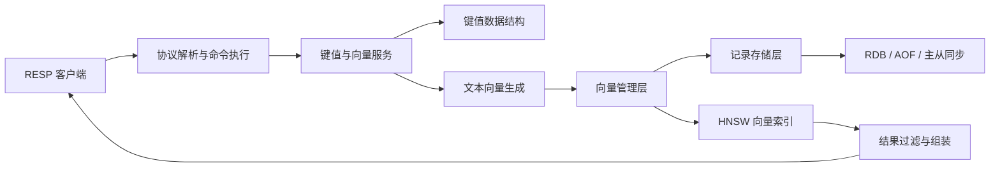
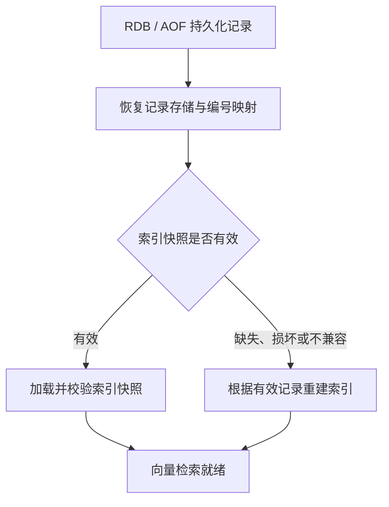

# KVLite

KVLite 是一个使用 C 语言实现的轻量级键值存储服务，面向服务端存储与人工智能基础设施场景。在统一的命令、持久化和数据管理框架中，项目进一步集成了文本向量生成与语义检索能力。

---

## 1. 项目简介

当前主要能力包括：

- 普通键值存储：RESP 协议、四种数据结构、流水线处理（Pipeline）
- TTL 过期管理：惰性删除与后台扫描，支持 RDB/AOF 恢复
- RDB/AOF 持久化与重启恢复
- TCP / eBPF 主从同步基础设施
- `VSET` / `VGET` / `VSEARCH` / `VDEL` / `VINDEX` / `VINFO` 向量命令
- 用于确定性测试的哈希向量，以及可选的 ONNX Runtime 本地文本向量生成
- 记录存储、外部编号映射、结果过滤和返回内容组装
- 精确向量索引与 HNSW 近似最近邻索引
- HNSW 索引快照、同步或异步影子索引重建、增量重放和原子发布
- VINFO 提供索引状态、重建状态、快照状态以及 VSEARCH 各阶段性能统计

---

## 2. 核心特性

### 2.1 键值存储

- RESP 协议解析与命令分发
- `SET` / `GET` / `DEL` / `MOD` / `EXIST` 基础操作
- 数组、红黑树、哈希表和跳表四种存储结构复用统一命令框架
- `RANGE` / `SORT` 范围查询与排序
- 流水线请求处理

### 2.2 TTL

- `EXPIRE` / `TTL` / `PERSIST` / `PEXPIREAT` 命令
- `GET` / `EXIST` / `RANGE` / `SORT` / `FULLDUMP` 路径惰性过滤过期 key
- 轻量后台扫描线程兜底
- 覆盖写清理旧 TTL，`DEL` 同步清理 TTL 元数据
- RDB/AOF 恢复保持 TTL 语义

### 2.3 持久化与同步

- AOF 追加写，支持 `no` / `everysec` / `always` 三种 fsync 策略
- AOF 重写
- RDB 快照保存与加载
- 通过 RDB 加载和 AOF 重放恢复产品记录
- TCP 全量/增量同步和 eBPF 流量同步基础设施

### 2.4 向量检索

- 公开 RESP 向量命令覆盖写入、精确读取、近似检索、删除、重建和状态观测
- 问题与业务范围的精确映射，以及内部记录编号快速解析
- 业务范围、相似度阈值以及有效/删除状态过滤由向量管理层负责
- L2 标准化的 float32 向量与内积检索主路径
- KVLite HNSW 向量索引支持新增、搜索、删除标记、统计、重建和索引快照
- 精确向量索引作为精确检索基线、正确性校验依据和安全降级方案
- 同步重建与单次后台异步重建

---

## 3. 当前架构

### 3.1 产品调用链



普通键值命令直接进入统一存储框架。向量命令完成文本向量生成后，由向量管理层统一协调记录存储、编号映射和向量索引。产品记录是唯一的持久化数据依据，HNSW 图和索引快照均可由有效记录重新构建。

### 3.2 向量管理层与索引核心的职责边界

| 层次 | 主要职责 | 
| --- | --- | --- |
| 向量管理层 | 产品记录、问题与业务范围映射、过期状态、元数据、编号映射、结果过滤、持久化、同步协调、索引重建和返回内容组装 |
| 向量索引核心 | 根据内部记录编号和向量完成添加、删除、搜索与统计 |

这项职责划分保证向量索引可以由产品记录重新构建，同时避免底层索引直接依赖公开协议和业务字段。

### 3.3 索引后端状态

| 产品角色 | 内部名称 | 当前状态 |
| --- | --- | --- |
| 精确向量索引 | `core_flat` | 用于精确检索、正确性校验和异常降级 |
| HNSW 向量索引 | `core_hnsw_v2` | 当前主要近似检索后端，已完成 10 万条产品端到端验证 |
| FAISS 对照索引 | `faiss*` | 仅用于纯索引基准对比，尚未接入产品命令链路 |

### 3.4 主要目录

| 路径 | 作用 |
| --- | --- |
| `src/core/` | 服务配置、RESP 命令分发与执行、持久化和产品入口 |
| `src/vector/` | 向量管理、记录存储、索引重建、快照和索引适配 |
| `src/vector/core/` | 独立的精确索引与 HNSW 索引核心实现 |
| `include/vector/` | 向量管理、索引、重建和快照的内部接口 |
| `scripts/benchmark/` | 纯索引、真实文本向量和产品端到端基准测试工具 |
| `tests/` | 键值存储、索引核心、产品集成、快照/重建和基准测试冒烟用例 |
| `docs/` | 架构设计、阶段报告、基准测试证据和职责边界说明 |

---

## 4. 快速启动

### 4.1 普通构建

```bash
make -j"$(nproc)"

# 默认读取 config/kvstore.conf
./kvstore

# 或使用显式配置
./kvstore -c config/master.conf
```

### 4.2 KVLite HNSW 向量索引

```bash
./kvstore -c config/kvstore.conf \
  --vector_index_type core_hnsw_v2 \
  --vector_hnsw_initial_capacity 100000
```

### 4.3 ONNX 文本向量构建

```bash
make setup-embedding
make embedding -j"$(nproc)"

./kvstore -c config/kvstore-embedding.conf \
  --vector_index_type core_hnsw_v2 \
  --vector_hnsw_initial_capacity 100000
```

`make setup-embedding` 准备 ONNX Runtime 和 `bge-small-zh-v1.5` 模型；`make embedding` 构建 `local_c` 文本向量生成实现。

---

## 5. 命令体系

KVLite 的普通键值、过期管理、持久化和向量命令共用 RESP 协议解析、任务调度和命令执行框架。向量命令在统一命令体系之上增加文本向量生成、产品记录管理和向量索引处理。

| 类别 | 命令 | 说明 |
| --- | --- | --- |
| 数组键值存储 | SET / GET / DEL / MOD / EXIST / RANGE / SORT | 默认键值数据结构 |
| 红黑树键值存储 | RSET / RGET / RDEL / RMOD / REXIST / RRANGE / RSORT | 红黑树存储 |
| 哈希键值存储 | HSET / HGET / HDEL / HMOD / HEXIST / HRANGE / HSORT | 哈希存储 |
| 跳表键值存储 | SSET / SGET / SDEL / SMOD / SEXIST / SRANGE / SSORT | 跳表存储 |
| 大值文档 | PAPERSET / PAPERGET / PAPERDEL / PAPERMOD | 基于红黑树的大值文档操作 |
| 过期管理 | EXPIRE / TTL / PERSIST / PEXPIREAT | 相对或绝对过期管理 |
| 持久化 | AOFREWRITE / FULLDUMP | 持久化控制与全量导出 |
| 向量记录 | VSET / VGET / VSEARCH / VDEL | 向量记录和搜索 |
| 向量索引控制 | VINDEX | 同步/异步重建和任务状态控制 |
| 运行状态观测 | VINFO | 向量、索引、内存和重建状态 |
| 连接控制 | QUIT | 连接控制 |

TTL 返回值：key 不存在返回 `-2`，永不过期返回 `-1`，其他情况返回剩余秒数。

---

## 6. 向量命令与数据模型

每条向量记录包含问题、答案、业务范围、文本向量和内部编号状态。问题、答案和业务范围属于产品数据；底层索引只处理内部记录编号和标准化向量。

### 6.1 命令矩阵

| 命令 | 用途 | 是否生成向量 | 产品记录 | 向量索引 | 类型 |
| --- | --- | --- | --- | --- | --- |
| `VSET question answer [scope]` | 新增或覆盖问答记录 | 是 | 写入或更新 | 新增、删除标记或更新 | 写 |
| `VGET question [scope]` | 根据问题和业务范围精确读取 | 否 | 只读 | 不变 | 读 |
| `VSEARCH query [scope] [topk] [threshold]` | 按语义相似度返回 topK 结果 | 是 | 只读 | 不变 | 读 |
| `VDEL question [scope]` | 删除问答记录 | 否 | 标记删除并移除编号映射 | 添加删除标记并记录删除增量 | 写 |
| `VINDEX REBUILD` | 同步重建派生索引 | 否 | 只读扫描有效记录 | 重建并发布 | 写/控制 |
| `VINDEX REBUILD ASYNC` | 启动后台影子索引重建 | 否 | 只读扫描并记录增量 | 重放、校验并发布 | 写/控制 |
| `VINDEX REBUILD STATUS` | 查询后台重建状态 | 否 | 不变 | 不变 | 读/观测 |
| `VINDEX REBUILD CANCEL` | 请求取消后台重建 | 否 | 不变 | 丢弃未发布的影子索引 | 写/控制 |
| `VINDEX REBUILD RETRY` | 失败或取消后重试 | 否 | 只读扫描有效记录 | 重新构建影子索引 | 写/控制 |
| `VINFO` | 查询记录、索引、性能、重建和快照状态 | 否 | 不变 | 不变 | 读/观测 |

`VSEARCH` 返回问题、答案、业务范围和相似度分数，不暴露内部记录编号或存储位置。业务范围、相似度阈值、有效/删除状态检查和返回格式均由向量管理层处理。

### 6.2 手工验证

先构建测试客户端：

```bash
make tests -j"$(nproc)"

./build/tests/bin/kvstore_client 127.0.0.1 9300 \
  -c "VSET 怎么重置密码 可以在登录页点击忘记密码 demo"

./build/tests/bin/kvstore_client 127.0.0.1 9300 \
  -c "VGET 怎么重置密码 demo"

./build/tests/bin/kvstore_client 127.0.0.1 9300 \
  -c "VSEARCH 忘记密码怎么办 demo 5 0.0"

./build/tests/bin/kvstore_client 127.0.0.1 9300 -c "VINFO"
```

真实 ONNX 相似度分数受模型、分词方式和业务语料影响，`threshold` 应根据实际数据标定。

---

## 7. HNSW 向量索引生命周期

### 7.1 当前索引、影子索引和待回收索引


HNSW 向量索引采用当前索引、影子索引和待回收索引的发布模型。后台重建是单次后台任务；`VSEARCH` 始终读取已经发布的当前索引，影子索引不直接服务用户查询。发布前必须完成记录、向量、校验和、增量版本以及搜索正确性的最终校验。发布失败时继续保留旧索引；发布后的快照写入失败不会回滚发布、不会让重建失败，也不会影响当前查询。

### 7.2 VDEL 与索引重建

`VDEL` 会标记产品记录删除、移除编号映射、回收记录存储位置、在当前索引中添加删除标记，并在重建期间记录删除增量。重建用于回收删除标记、压实派生状态并重新发布一致的索引。

---

## 8. 持久化与恢复



- KVLite 持久化的是产品记录，而不是将 HNSW 图作为用户数据真相。
- HNSW 图和索引快照用于加速检索与启动，可以由有效记录重新构建。
- 快照清单会校验来源、版本和索引结构；快照缺失、损坏或不兼容时，仅根据记录进行索引重建。
- 同步重建与异步发布后复用现有快照写入能力；快照采用尽力写入策略。
- RDB 加载、AOF 重放和索引重建都必须从有效记录恢复运行时编号映射与向量索引。

---

## 9. 文本向量、相似度与配置

当前真实语义检索主路径：

```text
文本
→ 分词
→ ONNX Runtime 推理
→ 512 维单精度向量
→ L2 标准化
→ KVLite HNSW 内积搜索
→ 产品记录解析与结果过滤
```

| 向量生成方式 | 用途 |
| --- | --- |
| `hash` | 不依赖模型的确定性功能测试，不代表真实语义效果 |
| `local_c` | 通过 C 接口调用本地 ONNX Runtime；当前使用 `bge-small-zh-v1.5` |

10 万条基准测试冻结参数如下。它们用于复现实验，不表示所有业务的默认最优值：

```ini
vector_index_type = core_hnsw_v2
vector_metric = ip
vector_hnsw_m = 48
vector_hnsw_ef_construction = 512
vector_hnsw_ef_search = 128
vector_hnsw_initial_capacity = 100000

embedding_provider = local_c
embedding_model_path = models/bge-small-zh-v1.5/model.onnx
embedding_dim = 512
```

更换模型、维度或标准化方式后，旧文本向量和派生索引不能继续混用。`efSearch` 需要根据真实数据的召回率与延迟重新选择；本次 README 更新没有修改产品默认参数。

---

## 10. 构建与测试

### 10.1 构建入口

```bash
# 默认构建；内置精确/HNSW 向量索引不依赖外部近似检索库
make clean
make -j"$(nproc)"

# 启用仓库现有外部依赖和基准测试构建开关
make ENABLE_HNSWLIB=1 ENABLE_FAISS=1 -j"$(nproc)"

# ONNX 文本向量构建
make setup-embedding
make embedding -j"$(nproc)"
```

`ENABLE_FAISS=1` 不会恢复 FAISS 产品索引后端；FAISS 仍只用于独立的纯索引基准对比。

### 10.2 核心回归测试入口

```bash
tests/vector_core_flat_correctness_test.sh
tests/vector_core_flat_rebuild_test.sh
tests/vector_core_flat_rdb_reload_test.sh

tests/vector_core_hnsw_v2_skeleton_test.sh
tests/vector_core_hnsw_v2_graph_construction_test.sh
tests/vector_core_hnsw_v2_search_recall_test.sh
tests/vector_core_hnsw_v2_product_integration_test.sh
tests/vector_core_hnsw_v2_default_backend_test.sh

tests/vector_rebuild_async_worker_test.sh
tests/vector_index_snapshot_load_after_records_test.sh
tests/vector_index_snapshot_shadow_publish_test.sh
```

---

## 11. 10 万条真实文本向量基准测试

### 11.1 统一测试背景

```text
数据集 = T2Ranking
模型 = bge-small-zh-v1.5
记录数 = 100000
查询数 = 200
向量维度 / 数据类型 = 512 / float32
标准化方式 / 相似度计算 = L2 / 内积
返回数量 = 10
M / M0 / efConstruction = 48 / 96 / 512
纯索引测试 = 单线程
```

### 11.2 KVLite HNSW 与 FAISS 纯索引对比

| 索引 | 构建时间 | 进程峰值内存 |
| --- | ---: | ---: |
| KVLite HNSW（`core_hnsw_v2`） | 678.327 秒 | 约 1.00 GiB |
| FAISS HNSW | 215.897 秒 | 约 1.08 GiB |

KVLite HNSW 构建时间约为 FAISS 的 `3.142` 倍。进程峰值内存包含不同测试工具和运行库开销，两者的内存统计口径也不同，因此不能据此直接判断索引本身谁更节省内存。

| `efSearch` | KVLite HNSW 召回率（recall@10）/ 平均延迟 | FAISS HNSW 召回率（recall@10）/ 平均延迟 |
| ---: | ---: | ---: |
| 64 | 0.9910 / 650 us | 0.9880 / 471 us |
| 128 | 0.9985 / 1120 us | 0.9955 / 835 us |
| 256 | 0.9995 / 1875 us | 0.9985 / 1507 us |
| 512 | 1.0000 / 3217 us | 1.0000 / 2748 us |

- 相同 `efSearch` 下，KVLite HNSW 的召回率始终不低于 FAISS HNSW，但 FAISS HNSW 的平均搜索延迟更低。
- 在召回率同为 `0.9985` 时，KVLite HNSW 使用 `efSearch=128`，其搜索延迟低于使用 `efSearch=256` 的 FAISS HNSW。
- 两者首次达到完全召回均需要 `efSearch=512`，此时 FAISS HNSW 的构建和搜索速度更快。
- FAISS 当前只用于纯索引对照，尚未接入 KVLite 产品命令链路。

### 11.3 KVLite HNSW 产品端到端测试

| `efSearch` | 召回率（recall@10） | 预计算向量端到端延迟 | 公开文本查询端到端延迟 |
| ---: | ---: | ---: | ---: |
| 128 | 0.9985 | 1.373 ms | 6.018 ms |
| 256 | 0.9995 | 2.235 ms | 6.821 ms |
| 512 | 1.0000 | 3.610 ms | 8.237 ms |

10 万条单实例加载结果：

```text
加载总时间 = 740.826 秒
加载吞吐率 = 134.985 条/秒
服务进程峰值内存约为 2.24 GiB
VSET 失败数 = 0
有效记录数 / 索引记录数 = 100000 / 100000
```

产品加载总时间约为纯索引构建时间的 `1.092` 倍。预计算向量路径只跳过分词和 ONNX 推理，其余产品链路保持不变。公开文本查询执行完整的文本向量生成流程，两条路径返回的记录编号和顺序完全一致。

在当前 10 万条、单客户端证据下，`efSearch=128` 是高质量与低延迟的平衡候选，`efSearch=256` 是高召回候选，`efSearch=512` 是完全召回与正确性校验候选。这些结论不自动修改产品默认参数，也不能外推为高并发服务等级。FAISS 没有产品索引后端，因此不存在公平的 FAISS 产品端到端数据。

---


## 12. 文档索引

| 类别 | 入口 |
| --- | --- |
| 总体架构 | [docs/architecture/README.md](docs/architecture/README.md) |
| 向量索引核心重构 | [docs/vector_core_reset/core_hnsw_v2_final_architecture.md](docs/vector_core_reset/core_hnsw_v2_final_architecture.md) |
| HNSW 向量索引产品化 | [docs/hnsw_productization/README.md](docs/hnsw_productization/README.md) |
| HNSW 索引快照 | [docs/hnsw_index_snapshot/README.md](docs/hnsw_index_snapshot/README.md) |
| HNSW 后台重建 | [docs/hnsw_rebuild_productization/README.md](docs/hnsw_rebuild_productization/README.md) |
| 真实文本向量基准测试 | [docs/vector_benchmark_readiness/README.md](docs/vector_benchmark_readiness/README.md) |

历史阶段报告保存实现证据和职责边界；根 README 只维护当前架构、可执行入口、最终基准测试结论和下一步路线。
