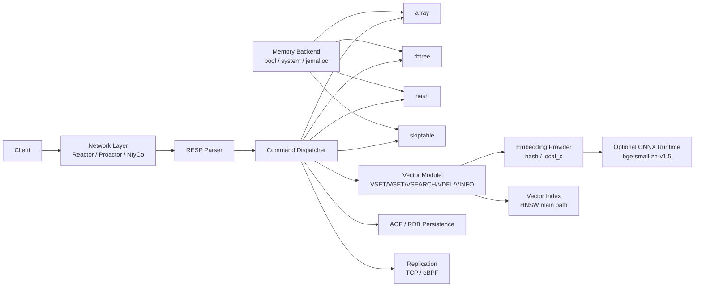
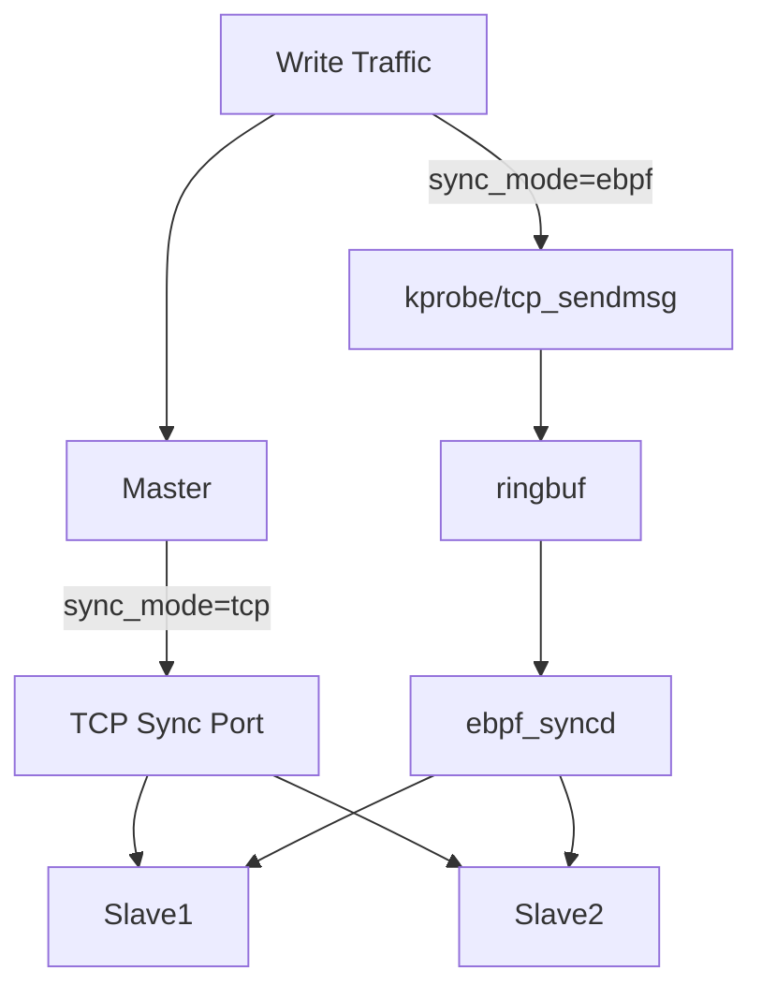
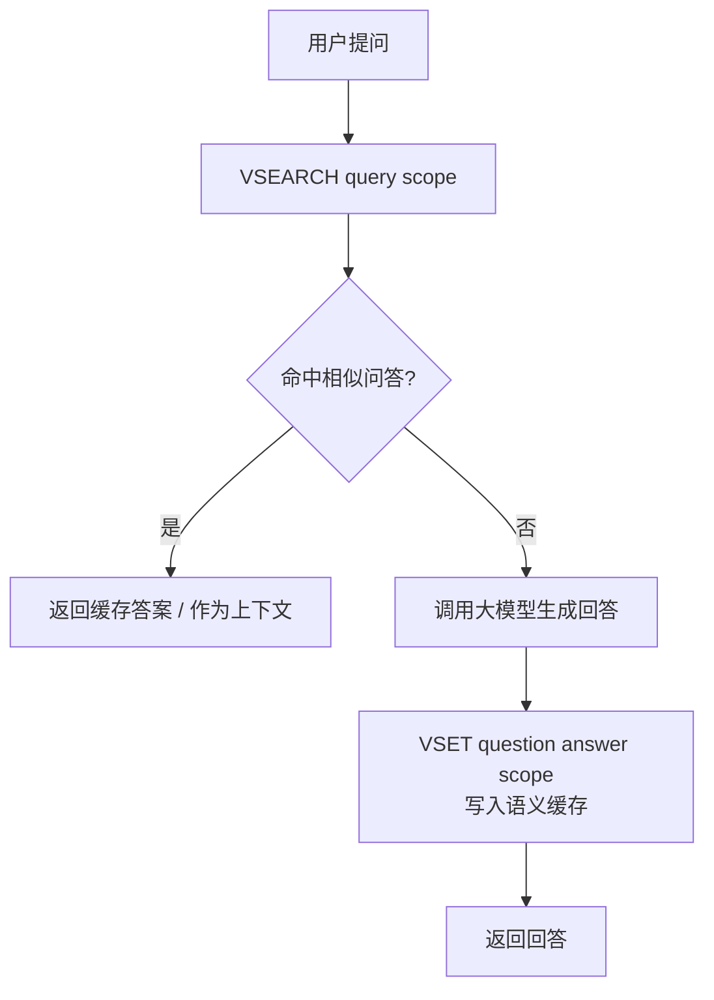

# KVLite

基于 C 语言实现的轻量级 KV 存储引擎，扩展面向 AI Chat / 知澜助手的向量语义缓存能力。

正式入口：

- 文档索引：`docs/INDEX.md`
- Route C 文档：`docs/route_c/README.md`
- 目录整理报告：`docs/project_layout_cleanup_report.md`
- Route C 已完工；测试脚本已删除，验证证据保留在 `docs/route_c/` 中。

---

## 1. 项目简介

KVLite：一个从 KV 存储延伸到向量语义缓存的轻量系统。当前

- 普通 KV 存储（RESP 协议、四种数据结构、Pipeline）
- TTL（惰性删除 + 后台扫描，RDB/AOF/主从同步中保持 TTL 语义）
- RDB/AOF 持久化与重启恢复
- TCP / eBPF 主从同步
- 向量语义缓存（V 族命令 + HNSW 索引）
- ONNX embedding 本地推理（可选构建）
- AI Chat 历史问答本地召回

---

## 2. 核心特性

### 2.1 KV 存储

- RESP 协议解析与命令分发
- SET / GET / DEL / MOD / EXIST 基础操作
- array / rbtree / hash / skiptable 四种存储结构，统一命令框架
- RANGE / SORT 范围查询与排序
- Pipeline 支持（已验证单次 100 万条命令）

### 2.2 TTL

- EXPIRE / TTL / PERSIST 命令
- 惰性删除：GET / EXIST / RANGE / SORT / FULLDUMP 路径上过滤过期 key
- 轻量后台扫描线程兜底
- 覆盖写自动清 TTL，DEL 同时清除 TTL 元数据
- RDB / AOF / TCP 主从 / eBPF 主从全链路保持 TTL 语义

### 2.3 持久化

- AOF 追加写（支持 no / everysec / always 三种 fsync 策略）
- AOF rewrite 压缩
- RDB 快照保存与加载
- 重启恢复：RDB 加载 + AOF 重放

### 2.4 主从同步

- TCP 主从同步：全量同步 + 增量复制
- eBPF 同步：kprobe/tcp_sendmsg 抓取 master 流量，ringbuf 传递到 ebpf_syncd，广播至 slave

### 2.5 向量语义缓存

- VSET / VGET / VSEARCH / VDEL / VINFO / VINDEX REBUILD 六个 V 族命令
- flat（精确）/ HNSW（ANN，默认推荐）两种索引
- IP / L2 / Cosine 三种相似度
- auto / fallback / AVX2 三种距离计算后端
- scope 维度支持多租户/多会话隔离
- 向量数据 RDB 持久化与 AOF 重放，HNSW 图通过 VINDEX REBUILD 重建

### 2.6 压测体系

- KV 与 Redis 同口径对齐压测（同参数、同工具、仅目标地址不同）
- 向量 latency 模式（单连接同步，观察延迟分布）
- 向量 throughput 模式（多连接 + pipeline，观察服务端极限吞吐）
- 自定义读写、内存后端对比、eBPF 批处理验证

---

## 3. 架构概览

### 3.1 总体架构



### 3.2 主从同步架构



### 3.3 向量语义缓存流程



---

## 4. 快速启动

### 4.1 普通构建

```bash
make

# 启动服务（默认会读取 config/kvstore.conf）
./kvstore

# 或显式指定配置文件
./kvstore -c config/master.conf
```

普通构建不依赖 ONNX Runtime，不需要模型文件。默认 embedding provider 可使用 `hash` / mock runtime，用于验证 VSET / VSEARCH / HNSW 主链路。

基础测试示例：

```bash
# 基础 KV 功能测试
./build/tests/bin/testcase 127.0.0.1 9300 5

# 向量功能测试
./build/tests/bin/vector_testcase 127.0.0.1 9300

# 向量压测（latency 模式）
BENCH_MODE=latency COUNT=100000 SEARCH_COUNT=10000 ./scripts/benchmark/bench_vector_rw.sh
```

### 4.2 ONNX embedding 构建

```bash
make setup-embedding
make embedding
./kvstore -c config/kvstore-embedding.conf
```

`make setup-embedding` 显式准备 ONNX Runtime 和 bge-small-zh-v1.5 模型文件；`make embedding` 编译带 ONNX embedding 的版本。用户不需要手写 `ENABLE_ONNX_EMBEDDING=1`、`ONNXRUNTIME_ROOT`、`LD_LIBRARY_PATH`，也不需要在启动命令中写 `embedding_model_path` / `embedding_dim`。

---

## 5. 基础 KV 命令

| 类型 | 命令 |
| --- | --- |
| array | SET / GET / DEL / MOD / EXIST / RANGE / SORT |
| rbtree | RSET / RGET / RDEL / RMOD / REXIST / RRANGE / RSORT |
| hash | HSET / HGET / HDEL / HMOD / HEXIST / HRANGE / HSORT |
| skiptable | SSET / SGET / SDEL / SMOD / SEXIST / SRANGE / SSORT |
| TTL | EXPIRE / TTL / PERSIST |
| 连接 | QUIT |

TTL 返回值约定：

- key 不存在 → `-2`
- 永不过期 → `-1`
- 其他 → 剩余秒数

RANGE / SORT 比较基于 `strcmp` 字典序，建议使用 zero-pad key（如 `key_000001`）获得数值顺序。

---

## 6. 向量语义缓存

KVLite 的 V 族命令用于 AI Chat 的本地语义缓存。每条记录包含四个维度：

| 维度 | 说明 |
| --- | --- |
| question | 用户问题（检索键） |
| answer | 回答内容 |
| scope | 隔离维度（user_id / session_id / tenant_id / project_id） |
| embedding | 由 question 生成的 float32 向量，进入索引前统一 L2 normalize |

### 6.1 VSET — 写入向量记录

```
VSET question answer scope
```

保存 question / answer / scope，根据 question 生成 embedding，写入当前向量索引。

### 6.2 VGET — 精确读取

```
VGET question scope
```

根据 question + scope 精确查找，返回对应 answer。

### 6.3 VSEARCH — 语义搜索

```
VSEARCH query topk [scope] [threshold]
```

根据 query 生成 embedding，在指定 scope 内搜索语义相似的历史 question，返回 topk 条结果（question / answer / scope / score）。

### 6.4 VDEL — 删除向量记录

```
VDEL question scope
```

删除指定记录，标记索引需要重建。

### 6.5 VINFO — 查看向量模块状态

```
VINFO
```

返回 total_records / active_records / deleted_records、index_type、metric、distance_backend、index_ready、needs_rebuild、各索引内部状态（HNSW M/ef 参数及图规模、SQ8 Flat 状态）、vector_memory_bytes / index_memory_bytes / total_vector_memory_bytes。

### 6.6 VINDEX REBUILD — 重建向量索引

```
VINDEX REBUILD
```

从所有活跃 record 的 embedding 重建索引。用于删除较多数据后清理、RDB/AOF 恢复后重建、索引状态异常修复。

> **当前不支持：** VBATCHSET、VSEARCH BATCH、VINDEX TRAIN、ivf_flat。所有当前索引均无需训练，写入立即可搜索。

---

### 6.7 手工验证示例

启动服务后，可以使用项目自带客户端验证：

```bash
./build/tests/bin/kvstore_client 127.0.0.1 28080 -c "VSET 怎么重置密码 可以在登录页点击忘记密码 onnx_demo"
./build/tests/bin/kvstore_client 127.0.0.1 28080 -c "VGET 怎么重置密码 onnx_demo"
./build/tests/bin/kvstore_client 127.0.0.1 28080 -c "VSEARCH 忘记密码怎么办 onnx_demo 5 0.0"
```

预期结果：

- `VSET` 返回 `OK`
- `VGET` 返回原答案
- `VSEARCH` 能召回“怎么重置密码”
- `score` 取决于模型、tokenizer 和数据集，建议用语义脚本观察分布后再设阈值

ONNX embedding 语义召回检查：

```bash
bash tests/vector/semantic_onnx_test.sh 127.0.0.1 28080
# 或
make test-embedding
```

脚本会写入几组中文问答，用 `0.0 / 0.70 / 0.75 / 0.80 / 0.85` 多个 threshold 查询，并打印每次返回的 score，方便标定 `vector_score_threshold`。

ONNX embedding 性能可通过 `build/tests/bin/vector_benchmark` 或 `make test-embedding` 验证，具体结果因硬件和模型而异。

## 7. 向量索引设计

### 7.1 Flat — 全量精确搜索

遍历所有向量计算距离，返回精确 topK。无需训练，适合小数据量（< 10K）、调试和 baseline 对比。

### 7.2 HNSW — 正式主路径

基于分层可导航小世界图的近似最近邻搜索（ANN）。无需训练，写入立即可搜索，适合在线写入和 AI Chat 语义检索。通过 `ef_search` 在精度与性能之间权衡。

---

## 8. 相似度与 Embedding

### 8.1 主路径相似度

当前语义缓存主路径固定为：

```text
embedding provider -> L2 normalized vector -> HNSW -> inner product -> semantic cache hit
```

向量在 KVLite adapter 层统一 L2 normalize；HNSW 使用 inner product，归一化后 score 可按 cosine similarity 理解。`flat` 保留为 debug / 单元测试 baseline，`sq8_flat` 保留为实验性压缩索引能力，不作为默认主路径。

### 8.2 距离计算后端

| backend | 说明 |
| --- | --- |
| `auto` | 默认，检测 CPU 支持 AVX2 则使用，否则回退 scalar |
| `fallback` | 强制标量 C 实现 |
| `avx2` | 优先 AVX2，CPU 不支持时回退 scalar |

### 8.3 Embedding 状态

普通构建默认可使用 `embedding_provider=hash`，通过确定性 hash / mock embedding 验证功能链路。

ONNX embedding 构建使用 `embedding_provider=local_c`，表示走 C ABI embedding runtime。当前第一版接入 bge-small-zh-v1.5 ONNX：

- `vocab.txt` 最小 WordPiece tokenizer
- ONNX Runtime `OrtRun`
- 读取 `sentence_embedding` 输出
- 模型输出维度为 `[1,512]`
- KVLite adapter 继续统一 L2 normalize

**hash / ONNX embedding 都可以验证：**
- VSET 生成向量 → 索引存储 → VSEARCH 返回结果 → RDB/AOF 恢复 → VINDEX REBUILD 重建

### 8.4 ONNX embedding 配置

`config/kvstore-embedding.conf` 是 ONNX embedding 模式的启动配置，关键项如下：

```ini
embedding_provider = local_c
embedding_model_path = models/bge-small-zh-v1.5/model.onnx
embedding_dim = 512
embedding_num_threads = 4
embedding_max_text_len = 512
embedding_ort_graph_opt_level = basic
embedding_inter_threads = 0
embedding_ort_execution_mode = sequential

vector_index_type = hnsw
vector_metric = ip
vector_score_threshold = 0.75
```

说明：

- `embedding_provider=local_c` 表示走 C ABI embedding runtime
- ONNX Runtime 是 `local_c` runtime 的一种编译实现
- `embedding_dim` 必须和模型输出 `sentence_embedding` 维度一致
- bge-small-zh-v1.5 ONNX 当前输出 `sentence_embedding [1,512]`
- `embedding_ort_*` 和 `embedding_inter_threads` 是 ONNX Runtime 实验参数，默认保持保守配置
- 向量由 KVLite adapter 层统一 L2 normalize
- HNSW 使用 `ip`，归一化后 score 可以按 cosine similarity 理解

### 8.5 为什么模型不提交到 git

`third_party/onnxruntime/` 和 `models/` 已被 `.gitignore` 忽略。

- ONNX Runtime 是平台相关二进制
- `model.onnx` / `model.onnx_data` 文件较大
- 不同用户可能使用不同平台、模型版本或镜像源
- 仓库只保存代码、配置和下载脚本
- 用户通过 `make setup-embedding` 显式下载依赖和模型

---

## 9. 推荐配置

```ini
vector_index_type=hnsw
vector_metric=ip
vector_hnsw_m=32
vector_hnsw_ef_construction=256
vector_hnsw_ef_search=256
vector_scope_overfetch_factor=4
distance_backend=auto
embedding_provider=hash
```

ONNX embedding 模式建议从 `vector_score_threshold=0.75` 起步，再根据 `tests/vector/semantic_onnx_test.sh` 输出的 score 分布调整。中文短问句、业务数据集和 tokenizer 差异都会影响阈值。

### 9.1 当前 ONNX embedding 限制

- tokenizer 是最小 WordPiece 实现，不是 Hugging Face tokenizer 的完整复刻
- 未实现 batch embedding
- 未实现 pooling，因为当前 ONNX 模型已有 `sentence_embedding` 输出
- 如果换成只输出 `last_hidden_state` 的模型，需要实现 CLS / mean pooling
- 换模型后旧向量索引不可复用，需要重新写入数据或 `VINDEX REBUILD`
- `vector_score_threshold` 需要按真实业务语料的 score 分布重新标定

### 9.2 ef_search 选择依据

测试条件：100K 向量、64 维、HNSW / IP / AVX2。

| ef_search | VSEARCH p99 | throughput QPS | top1 一致率 | top10 一致率 | 定位 |
| ---: | ---: | ---: | ---: | ---: | --- |
| 256 | 23.03ms | 73 | 100% | 100% | 高精度基准 |
| **128** | **2.02ms** | **1133** | **93.2%** | **96.5%** | **默认推荐** |
| 64 | 1.49ms | 3155 | 82.7% | 90.3% | 性能优先 |

- `ef_search=256`：精度基准，延迟和吞吐代价较大
- `ef_search=64`：性能最高，但 topK 一致率下降明显
- **`ef_search=128`：性能与精度的平衡点，默认推荐**

---

## 11. 性能压测

### 11.1 KV 基础压测

KVStore 与 Redis 同口径对比（`redis-benchmark`、`-c 50 -n 100000 -P 1 -d 32`）。

| ds | op | kvstore QPS | redis QPS | kv/redis |
| --- | --- | ---: | ---: | ---: |
| array | set | 115,340 | 105,708 | 1.09 |
| array | get | 108,696 | 94,877 | 1.15 |
| hash | set | 138,504 | 136,240 | 1.02 |
| hash | get | 136,612 | 129,870 | 1.05 |
| rbtree | set | 114,548 | 108,225 | 1.06 |
| rbtree | get | 115,473 | 114,025 | 1.01 |
| skiptable | set | 102,775 | 123,001 | 0.84 |
| skiptable | get | 105,820 | 117,371 | 0.90 |

四种结构均在 10 万+ QPS 区间。`array`/`hash`/`rbtree` 在 SET/GET 上与 Redis 持平或略优，`skiptable` 写路径略弱于 Redis。

> 完整数据：`results/raw.csv`、`results/summary.md`

**主从同步 QPS 对比（100K 写入，关闭 AOF）：**

| 模式 | array | rbtree | hash | skiptable |
| --- | ---: | ---: | ---: | ---: |
| Standalone | 17,668 | 16,594 | 16,897 | 17,324 |
| Master-Slave (TCP) | 17,156 | 16,056 | 16,452 | 16,559 |
| Master-Slave (eBPF 批处理) | 15,063 | 15,041 | 15,231 | 15,180 |
| Master-Slave (eBPF 无批处理) | 11,761 | 11,497 | 11,456 | 11,271 |

TCP 主从同步对写吞吐影响很小；eBPF 链路通过 tx_batcher 批处理可将吞吐提升约 30%。

### 11.2 向量压测

压测入口：`scripts/benchmark/bench_vector_rw.sh`，底层调用 `build/tests/bin/vector_benchmark`。

**Latency 模式** — 单连接同步请求，核心看 avg / p95 / p99，QPS 仅供参考：

```bash
BENCH_MODE=latency \
COUNT=100000 \
SEARCH_COUNT=10000 \
./scripts/benchmark/bench_vector_rw.sh
```

**Throughput 模式** — 多连接 + pipeline，核心看 QPS 并结合 p95 / p99 / errors：

```bash
BENCH_MODE=throughput \
COUNT=100000 \
SEARCH_COUNT=100000 \
VSET_CLIENTS=50 VSET_PIPELINE=1 \
VGET_CLIENTS=100 VGET_PIPELINE=16 \
VSEARCH_CLIENTS=50 VSEARCH_PIPELINE=4 \
VDEL_CLIENTS=100 VDEL_PIPELINE=16 \
./scripts/benchmark/bench_vector_rw.sh
```

**压测结论**（100K 向量、64 维、HNSW / IP / AVX2、ef_search=128）：

| 模式 | op | QPS | p50 | p95 | p99 |
| --- | --- | ---: | ---: | ---: | ---: |
| latency | VSET | — | 0.07ms | 0.11ms | 0.16ms |
| latency | VGET | — | 0.07ms | 0.11ms | 0.16ms |
| latency | VSEARCH | — | **0.99ms** | 1.49ms | **2.02ms** |
| throughput | VSET | 133,024 | 0.33ms | 0.56ms | 0.74ms |
| throughput | VGET | 164,761 | 1.68ms | 3.68ms | 5.32ms |
| throughput | VSEARCH | **1,133** | 171ms | 235ms | **272ms** |

当前 reactor 为单线程命令执行模型，VSEARCH 属于 CPU 密集型操作，吞吐受单次 HNSW 搜索耗时限制。通过调优 `ef_search=128`，在精度和性能之间取得平衡。

---

## 13. 快速索引

| 类别 | 路径 | 说明 |
| --- | --- | --- |
| 配置 | `config/master.conf` | 主节点配置 |
| 配置 | `config/slave.conf` | 从节点配置 |
| 配置 | `config/ebpf_sync.conf` | eBPF 同步配置 |
| 脚本 | `scripts/benchmark/bench_all.sh` | KV 对齐压测（KVStore vs Redis） |
| 脚本 | `scripts/benchmark/bench_vector_rw.sh` | 向量读写压测 |
| 测试 | `build/tests/bin/vector_testcase` | 向量 CRUD 功能测试 |
| 测试 | `tests/vector/semantic_onnx_test.sh` | ONNX embedding 中文语义召回与 score 分布检查 |
| 测试 | `build/tests/bin/vector_benchmark` | 向量压测工具 |
| 数据 | `results/raw.csv` | KV 压测原始数据 |
| 数据 | `results/vector_rw_raw.csv` | 向量压测原始数据 |