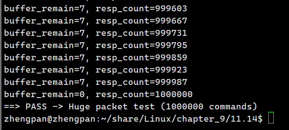
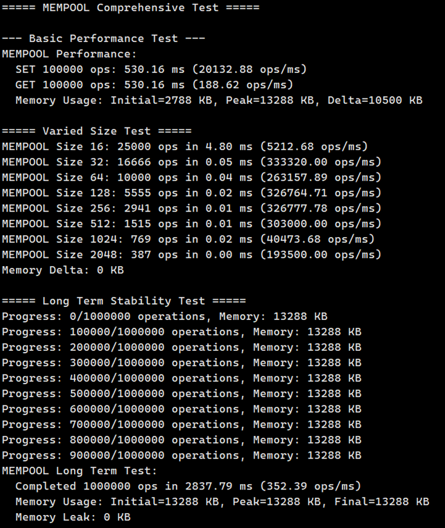
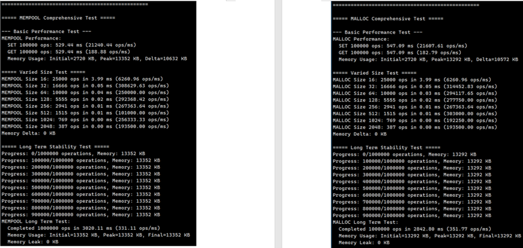
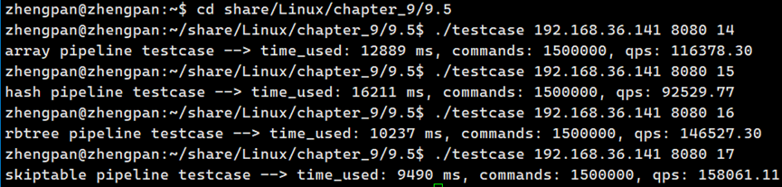
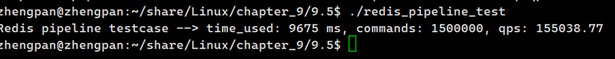
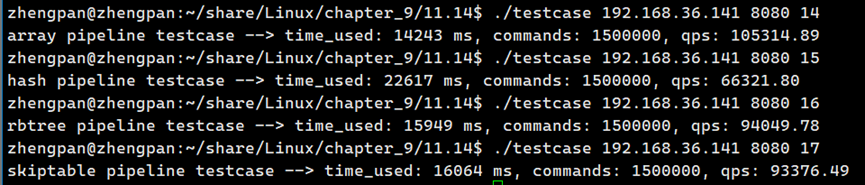

# KVStore （类 Redis KV 引擎）

一个类 Redis 的轻量级 KV 引擎，支持多种数据结构、RESP 协议、Pipeline、内存池、RDB/AOF 持久化，以及 TCP / eBPF 两种主从同步模式。

---

## 1. 基本功能概览

### 1.1 支持的数据结构

通过不同前缀区分数据结构，实现统一命令语义：

- 数组：`SET / GET / DEL / MOD / EXIST / RANGE / SORT`
- 红黑树：`RSET / RGET / RDEL / RMOD / REXIST / RRANGE / RSORT`
- 哈希表：`HSET / HGET / HDEL / HMOD / HEXIST / HRANGE / HSORT`
- 跳表：`SSET / SGET / SDEL / SMOD / SEXIST / SRANGE / SSORT`

### 1.2 基本操作（读写改查删除）

以数组为例（其他数据结构仅命令前缀不同）：

- 写入：`SET key value`
- 读取：`GET key`
- 修改：`MOD key value`
- 删除：`DEL key`
- 判断存在：`EXIST key`

返回（非 RESP 文本模式示意）：

- 成功：`+OK\r\n`
- 不存在：`-NO EXIST\r\n`

### 1.3 范围查询与排序

**范围查询 RANGE：**

- 数组：`RANGE startKey endKey`
- 红黑树：`RRANGE startKey endKey`
- 哈希表：`HRANGE startKey endKey`
- 跳表：`SRANGE startKey endKey`

**排序 SORT：**

- 数组：`SORT [high|low] [limit]`
- 红黑树：`RSORT [high|low] [limit]`
- 哈希表：`HSORT [high|low] [limit]`
- 跳表：`SSORT [high|low] [limit]`

参数规则说明：

- 不带参数：按 key 升序，返回全部
- 第一个参数：
  - `high`：降序
  - `low`：升序
  - 其他：解析为 limit（返回前 N 条）
- 第二个参数：limit

示例：

```text
SORT
SORT high
SORT 10
SORT low 5
```

### 1.4 Pipeline 与 RESP 协议

内部自带 RESP 解析器，支持 Redis 风格的 Pipeline：

- 数组命令示例：

```text
*3\r\n$3\r\nSET\r\n$3\r\nk1\r\n$3\r\nv1\r\n
*2\r\n$3\r\nGET\r\n$3\r\nk1\r\n
*2\r\n$5\r\nEXIST\r\n$3\r\nk1\r\n
```

- 四种网络模型均支持：Reactor（epoll）、Proactor（io_uring）、协程（NtyCo）、简单阻塞测试客户端（`testcase.c`）。



---

## 2. 支持命令汇总

### 2.1 数组（Array）

```text
SET key value
GET key
DEL key
MOD key value
EXIST key
RANGE startKey endKey
SORT [high|low] [limit]
```

### 2.2 红黑树（RBTree）

```text
RSET key value
RGET key
RDEL key
RMOD key value
REXIST key
RRANGE startKey endKey
RSORT [high|low] [limit]
```

### 2.3 哈希表（Hash）

```text
HSET key value
HGET key
HDEL key
HMOD key value
HEXIST key
HRANGE startKey endKey
HSORT [high|low] [limit]
```

### 2.4 跳表（SkipTable）

```text
SSET key value
SGET key
SDEL key
SMOD key value
SEXIST key
SRANGE startKey endKey
SSORT [high|low] [limit]
```

### 2.5 其他

```text
QUIT    # 关闭连接 / 触发服务退出流程
```

---

## 3. 内存池与碎片化优化

项目提供一套自定义内存池，用于替代系统 `malloc/free`，降低小对象碎片化，提高长时间运行稳定性。

### 3.1 使用方式

- 默认使用内存池：

```c
#include "include/kvs_memory.h"

void *p = kvs_malloc(128);
kvs_free(p);
p = kvs_realloc(p, 256);
char *s = kvs_strdup("hello");
```

- 切换到系统 `malloc/free`（用于对比测试）：

在 `kvstore.h` 中定义 `USE_MEMPOOL` 宏，即可让 `kvs_malloc` 退化为 `malloc`：

```c
#define USE_MEMPOOL 1
```

### 3.2 性能对比测试

使用 `kvs_perf.c` 对比系统 `malloc` 与内存池 `kvs_malloc`：

编译命令：

```bash
gcc -o kvs_perf kvs_perf.c kvs_array.c kvs_hash.c kvs_rbtree.c kvstore.c \
    ntyco.c proactor.c reactor.c kvs_mempool.c kvs_skiptable.c \
    -I ./NtyCo/core/ -L ./NtyCo/ -lntyco -lpthread -luring -ldl
```

> 注意：测试时可以暂时注释 `kvstore.c` 中的 `main` 函数。

运行：

```bash
./kvs_perf
```

示例输出截图：



---

## 4. 持久化：RDB / AOF

### 4.1 RDB 快照

代码：`kvs_rdb.c`

- 保存：`kvs_rdb_save("kvstore.rdb");`
- 加载：`kvs_rdb_load("kvstore.rdb");`

开启开关（在 `kvstore.h`）：

```c
#define ENABLE_RDB 1
```

在 `main` 退出时会自动保存：

```c
#if ENABLE_RDB
    kvs_rdb_save("kvstore.rdb");
#else
    kvs_save_all("kvstore.dat");
#endif
```

### 4.2 AOF 追加日志

代码：`kvs_aof.c`, `kvs_aof_rewrite.c`, 头文件：`include/kvs_aof.h`

外部 API：

```c
int  aof_init(const char *filename, int fsync_mode);
void aof_append(int argc, char **argv);
void aof_fsync(int force);
void aof_rewrite(void);
int  aof_load(const char *filename);
void aof_rewrite_background(void);
```

同步策略（`fsync_mode`）：

- `AOF_FSYNC_NO`：不主动 fsync（性能高，安全性低）
- `AOF_FSYNC_EVERYSEC`：每秒后台 fsync（推荐）
- `AOF_FSYNC_ALWAYS`：每次写后 fsync（最安全）

命令行示例：

```bash
# 每秒 fsync
./kvstore 2000 --aof_fsync everysec --aof_filename kvstore.aof

# 每次写都 fsync
./kvstore 2000 --aof_fsync always --aof_filename kvstore.aof
```

AOF 重写（减少文件体积）：

- 前台：`aof_rewrite();`
- 后台：`aof_rewrite_background();`

内部会遍历当前数据结构，生成一份新的精简 AOF，然后**原子替换**老文件。

---

## 5. 主从同步：TCP / eBPF

项目支持两种主从同步模式，通过 `sync_mode.h` 配置：

```c
#define SYNC_MODE_TCP  0 // 传统 TCP 同步
#define SYNC_MODE_EBPF 1 // 基于 eBPF 的同步

#ifndef SYNC_MODE
#define SYNC_MODE SYNC_MODE_EBPF
#endif
```

qps测试

- 无从节点：




- 启动从节点：



### 5.1 启动角色与端口

**Master：**

```bash
./kvstore 2000
# 服务端口：2000
# 同步端口：2000 + 1000 = 3000
```

**Slave：**

```bash
./kvstore --master <master_ip> <master_port> <slave_listen_port>
# 示例：
./kvstore --master 127.0.0.1 2000 2001
# Slave 服务端口：2001
# 会自动连接 Master 的 sync 端口 3000 做全量 + 增量同步
```

Slave 上禁止直接写入，写命令会返回只读错误（逻辑见 `kvs_filter_protocol`）。

### 5.2 TCP 模式

- 宏：`SYNC_MODE_TCP`
- 写命令在 Master 本地执行成功后，调用：

```c
master_sync_command(cmd, key, value);
```

通过普通 TCP 连接，将命令转发给所有已连接的 Slave。

### 5.3 eBPF 模式

- 宏：`SYNC_MODE_EBPF`
- 写命令在 Master 本地执行成功后，调用：

```c
ebpf_emit_sync_event(tokens, count);
```

流程：

1. 用户态函数 `ebpf_emit_sync_event_internal` 被 uprobe 挂载；
2. 内核 eBPF 程序 `ebpf_sync.bpf.c` 读取用户态参数（cmd/key/value），写入 ringbuf；
3. 用户态守护线程 `ebpf_sync_daemon` 从 ringbuf 取出事件，组装 RESP 命令；
4. 通过 `global_dist_config` 中记录的 Slave 列表，将命令分发给所有 Slave。

eBPF 初始化接口（Master 端）：

```c
int ebpf_sync_init(int sync_port);
void ebpf_sync_cleanup(void);
```

---

## 6. 编译与运行

> 下面给出一个参考编译命令，实际推荐使用 Makefile/CMake。

### 6.1 编译服务端

```bash
gcc -o kvstore \
    kvstore.c \
    reactor.c proactor.c ntyco.c \
    kvs_array.c kvs_hash.c kvs_rbtree.c kvs_skiptable.c \
    kvs_mempool.c kvs_rdb.c kvs_aof.c kvs_aof_rewrite.c \
    distributed.c ebpf_sync.c \
    resp_protocol.c \
    -I ./include -I ./NtyCo/core \
    -L ./NtyCo -lntyco -lpthread -luring -ldl
```

如需启用/切换同步模式，可在编译时指定：

```bash
# 使用 TCP 主从同步
gcc ... -DSYNC_MODE=SYNC_MODE_TCP

# 使用 eBPF 主从同步（需内核支持 eBPF & libbpf）
gcc ... -DSYNC_MODE=SYNC_MODE_EBPF
```

### 6.2 自带测试程序

`testcase.c` 提供了大量功能与压力用例，可以编译为单独客户端：

```bash
gcc -o testcase testcase.c -lhiredis -lpthread
```

使用：

```bash
./testcase <ip> <port> <mode>
# 常见 mode：
#  2  : 数组基本功能
#  3  : 哈希基本功能
#  4  : 跳表基本功能
#  10~13 : 各数据结构 RESP 测试
#  14~17 : 各数据结构 pipeline QPS 测试
#  18 : 大包压力测试
```

---

## 7. 架构简要说明

- 协议层：`resp_protocol.*`  
  负责 RESP 解析、半包/粘包处理、多命令 Pipeline 支持；
- 存储层：`kvs_array.*`, `kvs_rbtree.*`, `kvs_hash.*`, `kvs_skiptable.*`  
  实现四种数据结构的统一 API；
- 内存层：`kvs_mempool.*`  
  提供小块内存池与大块分配记录，统一 `kvs_malloc/kvs_free`；
- 持久化层：`kvs_rdb.*`, `kvs_aof.*`, `kvs_aof_rewrite.*`  
  提供 RDB 快照与 AOF 日志双机制；
- 分布式与同步层：`distributed.c`, `sync_mode.h`, `ebpf_sync.*`, `ebpf_sync.bpf.c`  
  提供 Master/Slave 管理，与 TCP/eBPF 两种同步实现；
- 网络层：`reactor.c`（epoll）、`proactor.c`（io_uring）、`ntyco.c`（协程）  
  封装事件循环，将解析后的命令交给 `kvs_filter_protocol` 处理。