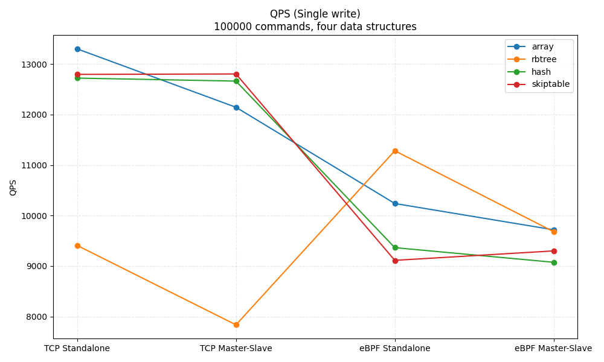
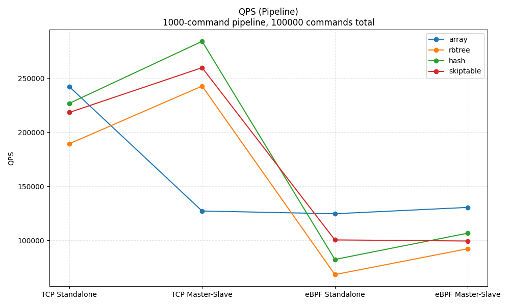
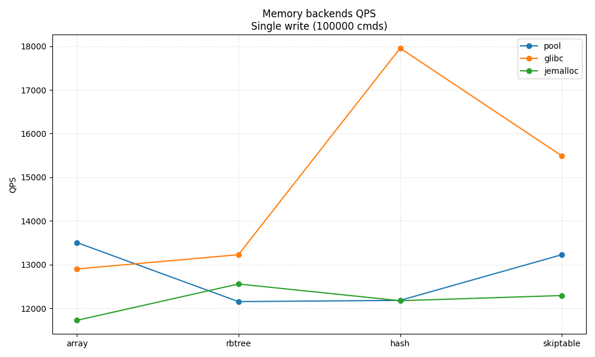
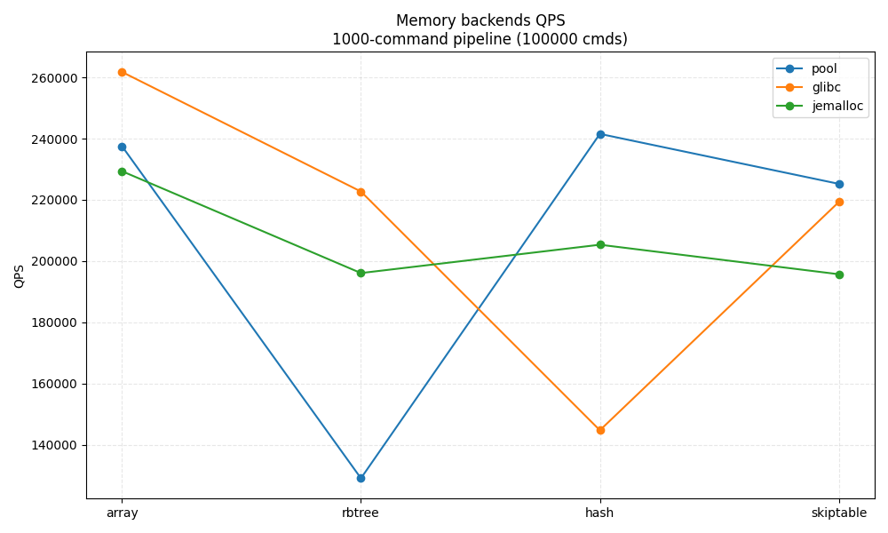

# KVStore 

项目现在支持通过简单的 `key=value` 配置文件集中管理启动参数，并允许命令行覆盖关键项。
## KVStore

一个类 Redis 的轻量级 KV 引擎，支持多种数据结构、RESP 协议 & Pipeline、内存池、RDB/AOF 持久化，以及 TCP / eBPF 两种主从同步模式，并通过统一配置文件完成启动参数管理。

---

## 1. 功能概览

- **数据结构**：数组 / 红黑树 / 哈希表 / 跳表
  - 数组：`SET / GET / DEL / MOD / EXIST / RANGE / SORT`
  - 红黑树：`RSET / RGET / RDEL / RMOD / REXIST / RRANGE / RSORT`
  - 哈希表：`HSET / HGET / HDEL / HMOD / HEXIST / HRANGE / HSORT`
  - 跳表：`SSET / SGET / SDEL / SMOD / SEXIST / SRANGE / SSORT`
- **协议**：自研 RESP 解析器，兼容 Redis 风格，多命令 Pipeline
- **持久化**：RDB 快照 + AOF 追加日志，支持重写
- **分布式**：主从复制（TCP / eBPF 两种同步实现）
- **内存管理**：自定义内存池 + jemalloc 封装 + glibc内存管理
- **网络模型**：Reactor（epoll）/ Proactor（io_uring）/ NtyCo 协程

---

## 2. 代码结构

- `src/core/`：核心入口 & 全局配置
  - `kvstore.c`：主函数，加载配置、初始化引擎、启动网络循环
  - `kvs_config.c`：配置解析与命令行参数合并逻辑
  - `kvs_globals.c`：全局配置 `g_cfg`、全局数据结构实例
- `src/storage/`：四种数据结构 + 内存池
- `src/persistence/`：RDB、AOF 以及 AOF 重写
- `src/network/`：RESP 协议解析 + Reactor/Proactor/NtyCo 三种网络实现
- `src/distributed/`：主从同步、eBPF 相关代码
- `include/`：公共头文件（命令表、配置、类型定义等）
- `tests/`：功能测试 & QPS 压测客户端

---

## 3. 编译

项目已经提供 `Makefile`，推荐直接使用：

```bash
make            # 默认 SYNC_MODE=0，使用 TCP 同步
make SYNC_MODE=1  # 启用 eBPF 同步，需要 libbpf/clang 等环境和 root 运行权限
```

生成的二进制文件：

- 服务端：`kvstore`
- 测试客户端：
  - `tests/testcase`：协议正确性、主从同步、大pipeline压测
  - `tests/write_qps_test`：单机写入QPS、主从写入QPS
  - `tests/kvstore_client`：交互式、管道式客户端
  - `tests/test_paper`：单机写入、获取、修改、删除大value
  - `tests/test_paper_sync`：主从同步写入、获取、修改、删除大value

> 如果使用 eBPF 模式，`Makefile` 会在 `src/distributed/` 下自动生成并编译 `ebpf_sync.bpf.o`，要求内核导出 `/sys/kernel/btf/vmlinux` 且已安装 `bpftool`、`clang`、`libbpf` 相关开发包。

---

## 4. 配置与启动

### 4.1 配置文件位置

- 默认配置：`config/kvstore.conf`
- 已提供示例：
  - `config/master.conf`：主节点
  - `config/slave.conf`：从节点

### 4.2 支持的主要配置项

见 `include/kvs_config.h`，典型字段：

- `port`：服务监听端口
- `role`：`master` / `slave`
- `master_ip`：从节点连接的主节点 IP
- `master_port`：主节点端口
- `sync_port`：主从同步端口
  - 若未配置，master 默认 `port + 1000`
  - slave 默认 `master_port + 1000`
- `enable_aof`：`yes/no/true/false/0/1`
- `aof_fsync_mode`：`no / everysec / always`：系统决定同步/每秒一次同步/每次写命令都同步
- `aof_filename`：AOF 文件名
- `rdb_filename`：RDB 文件名
- `mem_backend`：`pool / system / jemalloc`：自定义内存池/glibc/jemalloc
- `network_mode`：`reactor / proactor / ntyco`

### 4.3 Master 示例（`config/master.conf`）

```ini
port=8080
role=master

# 持久化
enable_aof=yes
aof_fsync_mode=everysec
aof_filename=kvstore-master.aof
rdb_filename=kvstore-master.rdb
dump_filename=kvstore-master.dat

# 网络模型
network_mode=ntyco
```

### 4.4 Slave 示例（`config/slave.conf`）

```ini
port=8081
role=slave

master_ip=127.0.0.1
master_port=8080

enable_aof=yes
aof_fsync_mode=everysec
aof_filename=kvstore-slave.aof
rdb_filename=kvstore-slave.rdb
dump_filename=kvstore-slave.dat

network_mode=ntyco
```

### 4.5 启动方式

**Master：**

```bash
./kvstore --config config/master.conf
```

**Slave：**

```bash
./kvstore --config config/slave.conf
```

命令行参数可以覆盖配置文件中的部分字段，例如：

```bash
./kvstore --config config/master.conf --aof_fsync always
```

> Slave 节点会自动连接 master 的同步端口，并做全量 + 增量同步；在 Slave 上执行写命令会返回只读错误。

---

## 5. 协议与命令

### 5.1 基本命令

- 数组

  ```text
  SET key value
  GET key
  DEL key
  MOD key value
  EXIST key
  RANGE startKey endKey
  SORT [high|low] [limit]
  ```

- 红黑树

  ```text
  RSET key value
  RGET key
  RDEL key
  RMOD key value
  REXIST key
  RRANGE startKey endKey
  RSORT [high|low] [limit]
  ```

- 哈希表

  ```text
  HSET key value
  HGET key
  HDEL key
  HMOD key value
  HEXIST key
  HRANGE startKey endKey
  HSORT [high|low] [limit]
  ```

- 跳表

  ```text
  SSET key value
  SGET key
  SDEL key
  SMOD key value
  SEXIST key
  SRANGE startKey endKey
  SSORT [high|low] [limit]
  ```

- 大key大value

  ```text
  PAPERSET key value
  PAPERSGET key
  PAPERDEL key
  PAPERMOD key value
  ```

- 其他

  ```text
  QUIT  # 关闭连接 / 触发服务退出流程
  ```

### 5.2 RESP 与 Pipeline

项目内部使用 RESP 编解码，与 Redis 类似，例如：

```text
*3\r
$3\r
SET\r
$3\r
k1\r
$3\r
v1\r

*2\r
$3\r
GET\r
$3\r
k1\r
```

支持在同一 TCP 连接上连续发送多条命令，服务端按顺序解析并返回结果，可用来做 pipeline QPS 压测（见 `tests/testcase.c` 中的 pipeline 测试）。

---

## 6. 持久化

### 6.1 RDB

- 代码：`src/persistence/kvs_rdb.c`
- 开关宏：`ENABLE_RDB`
- 主流程：启动时加载 RDB，退出时自动保存当前内存数据到 `g_cfg.rdb_filename`。

### 6.2 AOF

- 代码：`src/persistence/kvs_aof.c`, `kvs_aof_rewrite.c`
- 启动时若 `enable_aof=yes`：
  - 调用 `aof_init(g_cfg.aof_filename, g_cfg.aof_fsync_mode)`
  - 读取 AOF 回放数据
- 运行过程中所有写命令都会通过 `aof_append` 记录；
- 支持 AOF 重写（前台/后台），减小文件体积。

典型命令行：

```bash
./kvstore --config config/master.conf --aof_fsync everysec
./kvstore --config config/master.conf --aof_fsync always
```

---

## 7. 主从同步

### 7.1 模式选择

通过编译参数 `SYNC_MODE` 选择：

- `SYNC_MODE=0`：TCP 同步（默认）
- `SYNC_MODE=1`：eBPF 同步（涉及 BPF 程序加载，**需要在 root/有 CAP_BPF 能力的用户下运行 kvstore**）

核心文件：

- `src/distributed/distributed.c`
- `src/distributed/sync_backend_tcp.c`
- `src/distributed/sync_backend_ebpf.c`
- `src/distributed/ebpf_sync.c`, `ebpf_sync.bpf.c`

### 7.2 行为说明

- Master：
  - 监听 `g_cfg.sync_port`，接收 Slave 连接
  - 写命令执行成功后调用 `master_sync_command`，通过 sync backend 广播到所有 Slave
- Slave：
  - 启动后连接 Master，同步全量数据，然后持续接收增量指令
  - 在本地重放写命令，并记录 AOF，以便 Slave 独立重启恢复
- eBPF 模式：
  - Master 端通过回环口发送特定同步流量，由 eBPF 程序在内核态抓取并转发

`tests/testcase.c` 中提供了 master-slave 一致性验证用例：

```bash
./tests/testcase <master_ip> <master_port> 6 <slave_ip> <slave_port>   # 数组
./tests/testcase <master_ip> <master_port> 7 <slave_ip> <slave_port>   # 红黑树
./tests/testcase <master_ip> <master_port> 8 <slave_ip> <slave_port>   # 哈希表
./tests/testcase <master_ip> <master_port> 9 <slave_ip> <slave_port>   # 跳表
```

---

## 8. 自带测试与压测

### 8.1 功能测试

`tests/testcase` 支持多种模式：

```bash
./tests/testcase <ip> <port> <mode>

# 单节点功能
# 1 : 数组 RESP 功能
# 2 : 红黑树 RESP 功能
# 3 : 哈希 RESP 功能
# 4 : 跳表 RESP 功能
# 5 : 大包（huge packet）压力测试

# 主从一致性
# 6 : 数组 master-slave 一致性（需要额外传 slave_ip slave_port）
# 7 : 红黑树 master-slave 一致性
# 8 : 哈希 master-slave 一致性
# 9 : 跳表 master-slave 一致性
```

### 8.2 Pipeline QPS 测试

`tests/write_qps_test.c`、`tests/testcase.c` 中提供了针对四种数据结构的 pipeline QPS 测试脚本，用于对比：

- 无从节点时的最大吞吐
- 挂载从节点后主从同步带来的性能影响（TCP / eBPF 模式对比）

### 8.3 PAPER 测试

`tests/test_paper.c`、`tests/test_paper_sync.c` 中提供了针对单机、主从同步的测试脚本，用于验证：

- 单机对大key大value的增删改查
- 主从同步对大key大value的增删改查
---

# 9 `kvstore_client` 交互客户端

源码：`tests/kvstore_client.c`，编译时 `make` 会自动生成二进制：`tests/kvstore_client`。

### 启动方式

```bash
# 交互模式
./tests/kvstore_client <ip> <port>

# 单条命令模式
./tests/kvstore_client <ip> <port> -c "CMD ..."
```

### 内置命令与功能

- 基本 KV 操作：`SET / GET / DEL` 以及 `RSET/RGET/RDEL`、`HSET/HGET/HDEL`、`SSET/SGET/SDEL`
- Paper 存取：
  - `PAPERSET key /path/to/paper`：从本地文件读取内容，写入服务器（底层用 RESP bulk 传输，使用 RBTree 存储）。
  - `PAPERMOD key /path/to/paper`：从本地文件读取内容，修改已有论文内容（语义类似 `MOD`）。
  - `PAPERGET key /path/to/save`：从服务器拉取内容，如果存在则按 bulk 方式写入本地文件并打印长度；如果不存在则打印 `NO EXIST`。
  - `PAPERDEL key`：删除论文，成功返回 `OK`，不存在返回 `NO EXIST`。
- 连接/退出：
  - `EXIT`：退出客户端
  - `SQUIT`：向服务器发送 `QUIT` 命令（客户端仍保持运行，服务器收到后会进入优雅关闭流程）
- 帮助与补全：
  - `HELP`：列出所有支持的客户端命令
  - `HELP <command>`：查看某个命令的说明与用法
  - 交互模式下，支持基于 readline 的命令自动补全和历史记录

### 使用示例

```bash
# 1）连接到本地 8080 端口，进入交互模式
./tests/kvstore_client 127.0.0.1 8080

kv> SET foo bar
kv> GET foo
kv> PAPERSET paper1 /home/user/paper.pdf
kv> PAPERGET paper1 /tmp/paper-copy.pdf
kv> PAPERMOD paper1 /home/user/paper-v2.pdf
kv> PAPERDEL paper1
kv> EXIT

# 2）非交互调用一条命令
./tests/kvstore_client 127.0.0.1 8080 -c "GET foo"
```

借助该客户端，可以方便地做手工调试、大 value/论文文件读写验证以及简单脚本化测试。

---

# 10. 快速入门脚本示例

1. 编译：

   ```bash
   make
   ```

2. 启动 master：

   ```bash
   ./kvstore --config config/master.conf
   ```

3. 另开终端，运行功能测试（以数组为例）：

   ```bash
   ./tests/testcase 127.0.0.1 8080 1
   ```

4. 启动 slave 并做一致性测试（可选）：

   ```bash
   ./kvstore --config config/slave.conf
   ./tests/testcase 127.0.0.1 8080 6 127.0.0.1 8081
   ```

5. 启动 客户端进行交互：

   ```bash
   ./kvstore --config config/master.conf
   ./tests/kvstore_client <masterip> <masterport> 交互模式
   ./tests/kvstore_client <masterip> <masterport> -c "单条命令"
   ```

# 11. 测试附录

  下图给出了部分测试结果的可视化对比（见 `images/` 目录）：

  - 图 1：不同数据结构在 TCP / eBPF、Standalone / Master-Slave 下的单次写 QPS 对比。

    

  - 图 2：不同数据结构在 TCP / eBPF、Standalone / Master-Slave 下的 pipeline QPS 对比。

    

  - 图 3：不同内存后端（pool / glibc / jemalloc）的基础 QPS 对比。

    

  - 图 4：不同内存后端在单次写 / pipeline 场景下的 QPS 对比。

    

  1. 单机与主从同步 QPS 差异

  **单次写（100000 条），TCP，QPS 对比**

  | Mode         | Structure | time_used (ms) | count    | QPS       |
  | ------------ | --------- | -------------- | -------- | --------- |
  | Standalone   | array     | 7518           | 100000   | 13301.41  |
  | Standalone   | rbtree    | 10629          | 100000   | 9408.22   |
  | Standalone   | hash      | 7860           | 100000   | 12722.65  |
  | Standalone   | skiptable | 7815           | 100000   | 12795.91  |
  | Master-Slave | array     | 8234           | 100000   | 12144.77  |
  | Master-Slave | rbtree    | 12763          | 100000   | 7835.15   |
  | Master-Slave | hash      | 7897           | 100000   | 12663.04  |
  | Master-Slave | skiptable | 7810           | 100000   | 12804.10  |

  **1000 条命令 pipeline（合计 100000 条），TCP，QPS 对比**

  | Mode         | Structure | time_used (ms) | count    | QPS       |
  | ------------ | --------- | -------------- | -------- | --------- |
  | Standalone   | array     | 413            | 100000   | 242130.75 |
  | Standalone   | rbtree    | 528            | 100000   | 189393.94 |
  | Standalone   | hash      | 441            | 100000   | 226757.37 |
  | Standalone   | skiptable | 458            | 100000   | 218340.61 |
  | Master-Slave | array     | 786            | 100000   | 127226.46 |
  | Master-Slave | rbtree    | 412            | 100000   | 242718.45 |
  | Master-Slave | hash      | 352            | 100000   | 284090.91 |
  | Master-Slave | skiptable | 385            | 100000   | 259740.26 |

  **单次写（100000 条），eBPF，QPS 对比**

  | Mode         | Structure | time_used (ms) | count    | QPS       |
  | ------------ | --------- | -------------- | -------- | --------- |
  | Standalone   | array     | 9767           | 100000   | 10238.56  |
  | Standalone   | rbtree    | 8863           | 100000   | 11282.86  |
  | Standalone   | hash      | 10679          | 100000   | 9364.17   |
  | Standalone   | skiptable | 10974          | 100000   | 9112.45   |
  | Master-Slave | array     | 10290          | 100000   | 9718.17   |
  | Master-Slave | rbtree    | 10330          | 100000   | 9680.54   |
  | Master-Slave | hash      | 11020          | 100000   | 9074.41   |
  | Master-Slave | skiptable | 10753          | 100000   | 9299.73   |

  **1000 条命令 pipeline（合计 100000 条），eBPF，QPS 对比**

  | Mode         | Structure | time_used (ms) | count    | QPS       |
  | ------------ | --------- | -------------- | -------- | --------- |
  | Standalone   | array     | 802            | 100000   | 124688.28 |
  | Standalone   | rbtree    | 1461           | 100000   | 68446.27  |
  | Standalone   | hash      | 1213           | 100000   | 82440.23  |
  | Standalone   | skiptable | 995            | 100000   | 100502.51 |
  | Master-Slave | array     | 766            | 100000   | 130548.30 |
  | Master-Slave | rbtree    | 1083           | 100000   | 92336.10  |
  | Master-Slave | hash      | 937            | 100000   | 106723.59 |
  | Master-Slave | skiptable | 1005           | 100000   | 99502.49  |

  2. 不同内存池对比

  **基础功能（pool / system / jemalloc 对比）**

  | BACKEND | PATTERN           | maxrss (KB) | QPS / OPS                    |
  | ------- | ----------------- | ----------- | ---------------------------- |
  | POOL    | small-fixed       | 210576      | qps-small = 27027027.03      |
  | POOL    | mid-fixed         | 210576      | read-heavy-small = 24005840  |
  | POOL    | big-after-frag    | 1029412     | time = 0 ms                  |
  | SYSTEM  | small-fixed       | 10176       | qps-small = 26315789.47      |
  | SYSTEM  | mid-fixed         | 52416       | read-heavy-small = 46167076.92 |
  | SYSTEM  | big-after-frag    | 1068024     | time = 0 ms                  |
  | JEMALLOC| small-fixed       | 10188       | qps-small = 25641025.64      |
  | JEMALLOC| mid-fixed         | 52428       | read-heavy-small = 49996000  |
  | JEMALLOC| big-after-frag    | 1068036     | time = 0 ms                  |

  **单次写（100000 条），不同内存后端 QPS 对比**

  | Backend | Structure | time_used (ms) | count  | QPS       |
  | ------- | --------- | -------------- | ------ | --------- |
  | pool    | array     | 7404           | 100000 | 13506.21  |
  | pool    | rbtree    | 8228           | 100000 | 12153.62  |
  | pool    | hash      | 8209           | 100000 | 12181.75  |
  | pool    | skiptable | 7560           | 100000 | 13227.51  |
  | glibc   | array     | 7752           | 100000 | 12899.90  |
  | glibc   | rbtree    | 7560           | 100000 | 13227.51  |
  | glibc   | hash      | 5570           | 100000 | 17953.32  |
  | glibc   | skiptable | 6456           | 100000 | 15489.47  |
  | jemalloc| array     | 8529           | 100000 | 11724.70  |
  | jemalloc| rbtree    | 7964           | 100000 | 12556.50  |
  | jemalloc| hash      | 8214           | 100000 | 12174.34  |
  | jemalloc| skiptable | 8135           | 100000 | 12292.56  |

  **1000 条命令 pipeline（合计 100000 条），不同内存后端 QPS 对比**

  | Backend | Structure | time_used (ms) | count  | QPS       |
  | ------- | --------- | -------------- | ------ | --------- |
  | pool    | array     | 421            | 100000 | 237529.69 |
  | pool    | rbtree    | 775            | 100000 | 129032.26 |
  | pool    | hash      | 414            | 100000 | 241545.89 |
  | pool    | skiptable | 444            | 100000 | 225225.23 |
  | glibc   | array     | 382            | 100000 | 261780.10 |
  | glibc   | rbtree    | 449            | 100000 | 222717.15 |
  | glibc   | hash      | 691            | 100000 | 144717.80 |
  | glibc   | skiptable | 456            | 100000 | 219298.25 |
  | jemalloc| array     | 436            | 100000 | 229357.80 |
  | jemalloc| rbtree    | 510            | 100000 | 196078.43 |
  | jemalloc| hash      | 487            | 100000 | 205338.81 |
  | jemalloc| skiptable | 511            | 100000 | 195694.72 |