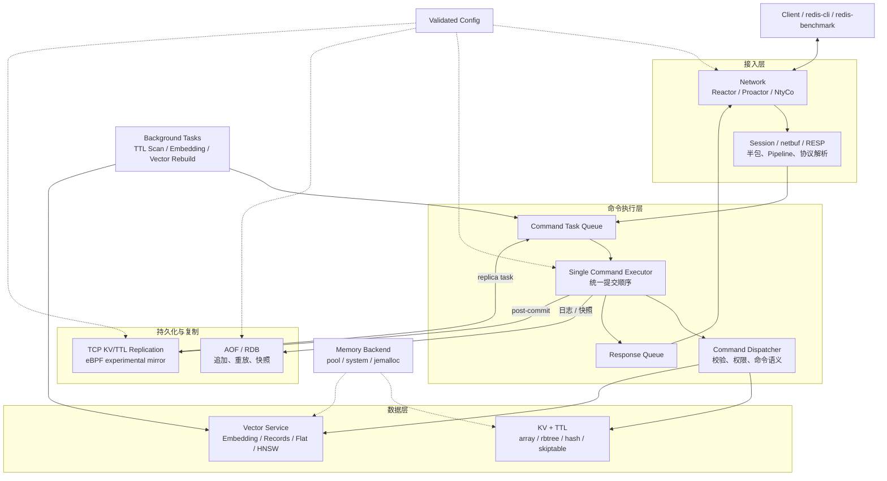
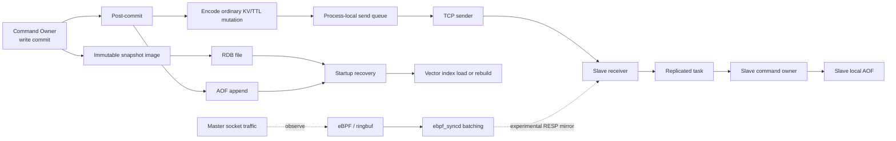
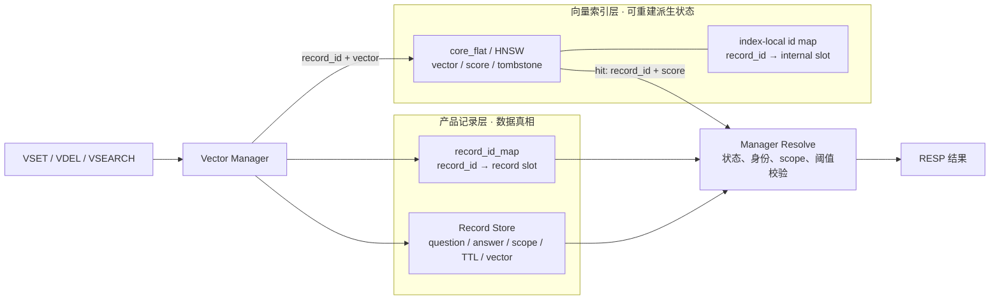
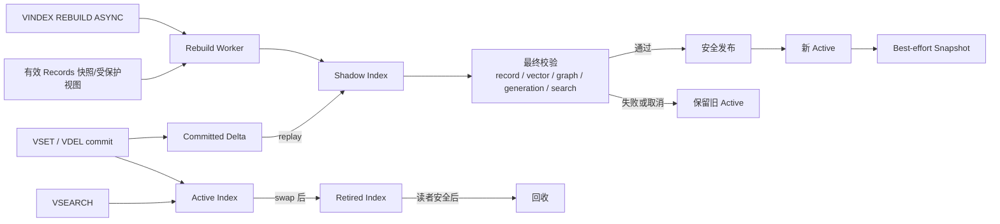

# Roven Engine

Roven 是一个使用 C 语言实现的轻量级键值存储服务，面向服务端存储与人工智能基础设施场景。在统一的命令、持久化和数据管理框架中，项目进一步集成了文本向量生成与语义检索能力。

---

## 1. 项目简介

当前主要能力包括：

- 普通键值存储：RESP 协议、四种数据结构、流水线处理（Pipeline）
- TTL 过期管理：惰性删除与后台扫描，支持 RDB/AOF 恢复
- RDB/AOF 持久化与重启恢复
- TCP / eBPF 主从同步基础设施
- `VSET` / `VGET` / `VSEARCH` / `VDEL` / `VINDEX` / `VINFO` 向量命令
- 用于确定性测试的哈希向量，以及可选的 ONNX Runtime 本地文本向量生成
- 记录存储、外部编号映射、结果过滤和返回内容组装
- 精确向量索引与 HNSW 近似最近邻索引
- HNSW 索引快照、同步或异步影子索引重建、增量重放和原子发布
- VINFO 提供索引状态、重建状态、快照状态以及 VSEARCH 各阶段性能统计

---

## 2. 核心特性

### 2.1 键值存储

- RESP 协议解析与命令分发
- `SET` / `GET` / `DEL` / `MOD` / `EXIST` 基础操作
- 数组、红黑树、哈希表和跳表四种存储结构复用统一命令框架
- `RANGE` / `SORT` 范围查询与排序
- 流水线请求处理

### 2.2 TTL

- `EXPIRE` / `TTL` / `PERSIST` / `PEXPIREAT` 命令
- `GET` / `EXIST` / `RANGE` / `SORT` / `FULLDUMP` 路径惰性过滤过期 key
- 轻量后台扫描线程兜底
- 覆盖写清理旧 TTL，`DEL` 同步清理 TTL 元数据
- RDB/AOF 恢复保持 TTL 语义

### 2.3 持久化与同步

- AOF 追加写，支持 `no` / `everysec` / `always` 三种 fsync 策略
- AOF 重写
- RDB 快照保存与加载
- RDB 保存产品记录及已生成的向量；AOF 保存并重放公开写命令
- 启动时按 RDB、AOF、派生索引校验/重建的顺序恢复
- 普通 KV/TTL 的 TCP 全量/增量同步，以及 eBPF 镜像基础设施

### 2.4 向量检索

- 公开 RESP 向量命令覆盖写入、精确读取、近似检索、删除、重建和状态观测
- 问题与业务范围的精确映射，以及内部记录编号快速解析
- 业务范围、相似度阈值以及有效/删除状态过滤由向量管理层负责
- L2 标准化的 float32 向量与内积检索主路径
- Roven HNSW 向量索引支持新增、搜索、删除标记、统计、重建和索引快照
- 精确向量索引作为精确检索基线、正确性校验依据和安全降级方案
- 同步重建与单次后台异步重建

---

## 3. 当前架构

### 3.1 系统总览



系统按“接入 → 执行 → 数据 → 持久化/复制”分层。网络层只处理连接、缓冲和 RESP；所有数据库可见操作进入单个 command executor，由命令分发器路由到普通 KV/TTL 或向量服务。成功写入在提交后进入 AOF 和 TCP 复制链路，后台线程只负责扫描、计算或派生索引工作。统一配置和内存后端为各运行模块提供基础能力。

### 3.2 请求路径与所有权

| 入口或任务 | Prepare / I/O 所在线程 | 数据库可见提交者 | 主要目标 |
| --- | --- | --- | --- |
| 普通 KV 读写 | Network owner 解析并创建 task | Command executor | array / rbtree / hash / skiptable |
| TTL 命令与惰性过期 | Network owner 创建 task；读路径可请求写语义重试 | Command executor | value 与 `expire_at_ms` |
| TTL 后台扫描 | TTL scanner 只负责定时提交任务 | Command executor | 小预算扫描和过期删除 |
| `VSET` / `VSEARCH` | Executor 或 embedding worker 生成任务私有向量 | Command executor | Vector manager、records、active index |
| `VGET` / `VDEL` / `VINDEX` | Network owner 创建 task | Command executor | Vector manager 与派生索引 |
| TCP replica apply | Replication receiver 解码私有帧并提交 replicated task | Command executor | 当前仅普通 KV/TTL |
| RDB/AOF 启动恢复 | 服务监听前的 startup owner | Startup owner | KV、TTL、vector records，再恢复派生索引 |
| RDB save / AOF rewrite | Executor 生成 immutable snapshot，后台或控制线程执行文件 I/O | Command executor 冻结快照内容 | 持久化文件 |
| 异步 HNSW rebuild | Rebuild worker 构建 shadow、重放 delta | 当前仍由 rebuild worker 受锁保护地发布 | 派生 HNSW 与索引快照 |

普通写命令的主路径是：

```text
network parse
  -> command task queue
  -> command executor validate/execute/commit
  -> post-commit AOF append and TCP handoff
  -> response queue
  -> network flush
```

只有已经成功提交的写命令才进入 post-commit。失败写和读命令不会产生 AOF/复制变更；replica apply 使用复制上下文，避免再次向下游传播。Embedding worker 只能准备 task-private embedding，不能分配 record ID 或直接修改 manager/core 状态。

### 3.3 数据层、数据真相与派生状态

| 子系统 | 数据真相 | 派生或缓存状态 | 关键语义 |
| --- | --- | --- | --- |
| 普通 KV | 四种存储结构中的 key/value 与 `expire_at_ms` | RANGE/SORT/FULLDUMP 的响应结果 | 覆盖写清 TTL；过期数据在读路径过滤，并由后台扫描兜底 |
| 向量检索 | Vector manager 持有的 records、稳定 record ID、question/answer/scope/metadata | `core_flat`、`core_hnsw_v2`、HNSW snapshot | Manager 负责过滤和响应；索引核心只处理 record ID、vector、score |
| AOF | 已提交公开写命令的追加日志 | Rewrite 生成的新 AOF 文件 | 启动时按命令语义重放；fsync 策略为 no/everysec/always |
| RDB | 某一时点的 KV/TTL 与 vector record snapshot | 文件编码与 immutable snapshot image | 保存记录和 embedding，不保存 HNSW 图 |
| HNSW snapshot | 无独立产品真相 | 可删除的启动加速缓存 | 校验失败、缺失或不兼容时从 records 重建 |

### 3.4 持久化与复制链路



TCP 路径使用私有二进制 op/key/value 帧复制普通 KV/TTL。所谓 full sync 是普通 KV 命令快照，不是 RDB 文件传输；当前没有 replication offset、ACK、durable backlog、partial resync、自动故障恢复或 promotion recovery。进程内发送队列只是瞬时发送缓冲，不能称为 backlog。

eBPF daemon 是独立进程：`observe` 只观测，`experimental_mirror` 通过 FULLDUMP 与捕获到的 RESP 写流量向 slave 转发，并使用 tx_batcher 聚合发送。它不是可靠复制传输，也不复制 vector records。当前 `VSET` / `VDEL` 不进入 TCP 或 eBPF 的确定性向量复制链路。

### 3.5 线程与并发模型

| 执行单元 | 主要职责 | 是否直接修改数据库状态 |
| --- | --- | --- |
| Network owner | socket、session、netbuf、RESP、任务提交与响应发送 | 否 |
| Command executor | 普通 KV、TTL、客户端向量命令、TCP replica apply、snapshot copy | 是，主要 runtime owner |
| TTL scanner | 周期唤醒并提交扫描任务 | 否 |
| Embedding workers | tokenizer/ONNX 或 hash embedding prepare | 否，只写 task-private 数据 |
| AOF worker / rewrite worker | fsync、rewrite 文件 I/O 与模块内部状态 | 否 |
| TCP accept / sender / receiver | 连接管理、编码发送、接收解码和 replicated task 提交 | 否 |
| Async rebuild worker | 构建 private shadow、重放 delta、更新状态并发布索引 | 是，当前受锁保护的第二 publisher |
| eBPF syncd | 独立进程中的内核事件消费、队列与批量转发 | 否；通过 slave 网络入口间接提交 |


### 3.6 模块与目录边界

| 路径 | 作用 |
| --- | --- |
| `src/core/` | 进程入口、统一配置、命令表、command task/executor、TTL 调度和生命周期编排 |
| `src/network/` | Reactor / Proactor / NtyCo、session、RESP 输入与响应发送 |
| `src/storage/` | array / rbtree / hash / skiptable、内存后端与 jemalloc 适配 |
| `src/persistence/` | AOF append/replay/rewrite 与 RDB save/load |
| `src/distributed/` | 普通 KV/TTL TCP full snapshot、增量编码、连接和发送队列 |
| `src/eBPF/` | eBPF 程序与独立 sync daemon；observe / experimental mirror |
| `src/vector/` | Vector manager、record store、embedding、重建、快照和 index adapter |
| `src/vector/core/` | `core_flat` 与 `core_hnsw_v2` 索引核心 |
| `src/utils/` | netbuf、消息队列、主从协议 codec、tx_batcher 与通用工具 |
| `config/` | 默认、embedding、TCP master/slave 等部署配置 |
| `scripts/benchmark/` | KV/Redis 对齐、向量和产品端到端 benchmark |
| `tests/` | 功能、持久化、复制、索引、故障路径和 benchmark 测试 |
| `docs/` | 当前审计、架构约束、阶段报告与原始证据索引 |

---

## 4. 命令体系

### 4.1 命令分类

| 类别 | 命令 | 作用 |
| --- | --- | --- |
| array | `SET GET DEL MOD EXIST RANGE SORT` | 默认 KV 引擎 |
| rbtree | `RSET RGET RDEL RMOD REXIST RRANGE RSORT` | 有序红黑树引擎 |
| hash | `HSET HGET HDEL HMOD HEXIST HRANGE HSORT` | 哈希表引擎 |
| skiptable | `SSET SGET SDEL SMOD SEXIST SRANGE SSORT` | 跳表引擎 |
| 大值文档 | `PAPERSET PAPERGET PAPERMOD PAPERDEL` | 基于红黑树的大 value 操作 |
| TTL | `EXPIRE TTL PERSIST PEXPIREAT` | 相对/绝对过期管理 |
| 持久化与导出 | `AOFREWRITE FULLDUMP` | AOF 重写和普通 KV 全量 RESP 导出 |
| 向量记录 | `VSET VGET VSEARCH VDEL` | 问答记录写入、精确读取、语义搜索和删除 |
| 向量控制 | `VINDEX VINFO` | 索引重建、任务控制和状态观测 |
| 连接控制 | `QUIT` | 关闭当前连接 |

### 4.2 统一执行语义

```text
RESP parse
  -> command task
  -> command executor
  -> validate / execute / commit
  -> AOF and ordinary KV/TTL replication post-commit
  -> ordered RESP response
```

- 普通 KV、TTL、向量命令和 TCP replica apply 由同一个 command executor 提交；网络线程不直接修改数据库。
- 成功写命令在 commit 后追加 AOF，并按配置交给普通 KV/TTL TCP 复制；失败写和读命令不产生 post-commit 变更。
- Slave 对普通客户端保持只读，复制连接通过独立上下文提交 replicated task，且不会再次向下游传播。
- 覆盖写会清除旧 TTL；`DEL` 同时清除 value 与 TTL 元数据。
- `TTL` 对不存在 key 返回 `-2`，对永不过期 key 返回 `-1`，其他情况返回剩余秒数。
- `FULLDUMP` 只导出有效普通 KV，并以 `PEXPIREAT` 保留有效 TTL；它不包含 vector records。

### 4.3 RANGE、SORT 与 Pipeline

- `RANGE` / `HRANGE` 使用 `command startKey endKey`，不接受 `LIMIT`。
- `RRANGE` / `SRANGE` 接受 `command startKey endKey` 或 `command startKey endKey LIMIT k`，其中 `k` 必须是正整数。
- `SORT` / `RSORT` / `HSORT` / `SSORT` 接受可选方向 `low|high` 和可选条数；默认按 key 的 `strcmp` 字典序升序。
- `GET` / `EXIST` 命中过期 key 时按不存在处理并触发清理；`RANGE` / `SORT` 遍历时跳过过期项。
- Pipeline 保持同一连接的命令和响应顺序；容量受请求/响应大小、`max_commands_per_read` 和连接内 single-inflight 机制约束。

### 4.4 向量命令与索引语义

| 命令 | 核心行为 |
| --- | --- |
| `VSET question answer [scope]` | 生成 embedding，新增或覆盖产品记录，并更新当前索引 |
| `VGET question [scope]` | 按 question + scope 精确读取产品记录 |
| `VSEARCH query [scope] [topk] [threshold]` | 生成查询向量，执行 topK 检索，再由 manager 完成 scope、阈值和有效状态过滤 |
| `VDEL question [scope]` | 删除产品记录映射，并在索引中记录 tombstone |
| `VINDEX REBUILD [ASYNC]` | 同步重建，或启动 shadow build、delta replay、校验和发布 |
| `VINDEX REBUILD STATUS/CANCEL/RETRY` | 查询、取消或重试异步重建任务 |
| `VINFO` | 返回记录、索引、embedding、快照和重建状态 |

向量路径可使用确定性 `hash` provider 或本地 ONNX `local_c` provider，生成 L2 标准化 float32 向量。Vector manager 持有 question、answer、scope、record ID、状态和结果组装；`core_flat` 与 `core_hnsw_v2` 只处理 record ID、vector 和 score。产品 records 是数据真相，HNSW 图及其 snapshot 都是可重建的派生状态。

#### record_id 与 HNSW 索引关系



`record_id` 是记录层和索引层之间唯一稳定的身份。Manager 的 record slot 与 HNSW 的 internal slot 分别管理、可独立复用；搜索命中后必须回到 manager，通过 `record_id_map` 定位记录，并再次校验 `record->id`、ACTIVE/删除状态、scope 和 threshold。索引核心不读取 question、answer、TTL 或 metadata，也不直接组装 RESP。

#### 后台异步重建



重建期间 `VSEARCH` 继续读取已发布的 active index。Worker 从有效 records 构建 shadow，并回放重建窗口内已提交的 `VSET/VDEL` delta；只有最终校验通过才交换 active，失败、取消或发布失败都继续保留旧 active。旧索引进入 retired，等待读者安全后回收；snapshot 写入失败不会回滚已经成功的发布。

持久化方面，RDB 保存 vector records 与 embedding，AOF 保存并重放公开 `VSET/VDEL`；AOF 重放 `local_c` VSET 时会重新执行 tokenizer/ONNX。模型、词表、维度、归一化方式和 metric 共同构成兼容边界。当前 async rebuild worker 仍会在锁保护下直接发布派生索引，因此数据库可见状态的单 owner 收敛尚未完全完成。

当前 TCP/eBPF 复制不包含 `VSET/VDEL`，也不复制 HNSW 图。向量复制必须以后续确定性 record mutation 为基础，不能通过在 replica 重放公开文本 VSET 来替代。

---

## 5. 快速启动与构建

### 5.1 默认构建与启动

```bash
make clean
make -j"$(nproc)"

# 默认读取 config/kvstore.conf
./kvstore

# 或使用显式配置
./kvstore -c config/master.conf
```

默认构建已包含 `core_flat` 与 `core_hnsw_v2`，不依赖外部近似检索库。运行配置来自校验后的 effective `kvs_config_t`，优先级为“内置默认值 < 配置文件 < 显式 CLI 覆盖”。

### 5.2 向量与 ONNX 构建

```bash
# 显式使用 Roven HNSW
./kvstore -c config/kvstore.conf \
  --vector_index_type core_hnsw_v2 \
  --vector_hnsw_initial_capacity 100000

# 构建外部 benchmark/reference 依赖
make ENABLE_HNSWLIB=1 ENABLE_FAISS=1 -j"$(nproc)"

# 准备 ONNX Runtime、模型并构建 local_c embedding
make setup-embedding
make embedding -j"$(nproc)"

./kvstore -c config/kvstore-embedding.conf \
  --vector_index_type core_hnsw_v2 \
  --vector_hnsw_initial_capacity 100000
```

FAISS/hnswlib 仅用于 benchmark/reference，不是产品索引后端。模型、词表和运行数据的相对路径分别从 `server.config_root` 与 `server.data_dir` 解析。

---

## 6. 功能与回归测试

### 6.1 测试构建与客户端

```bash
# 所有测试二进制统一输出到 build/tests/bin/
make tests -j"$(nproc)"

# RESP 测试客户端
./build/tests/bin/kvstore_client 127.0.0.1 8080
```

### 6.2 KV、TTL、持久化与复制回归

```bash
# 四种后端的 TTL、覆盖写、RANGE/SORT/FULLDUMP 过滤
CLIENT_BIN=./build/tests/bin/kvstore_client \
  tests/ttl/test_ttl_all_backends.sh

# RDB / AOF TTL 恢复
CLIENT_BIN=./build/tests/bin/kvstore_client tests/ttl/test_ttl_rdb.sh
CLIENT_BIN=./build/tests/bin/kvstore_client tests/ttl/test_ttl_aof.sh

# 普通 KV/TTL TCP 复制
CLIENT_BIN=./build/tests/bin/kvstore_client tests/ttl/test_ttl_tcp_replication.sh

# 需要匹配的 Linux/BPF 权限；环境不满足时按脚本门禁跳过
CLIENT_BIN=./build/tests/bin/kvstore_client tests/ttl/test_ttl_ebpf_replication.sh
```

### 6.3 向量核心与生命周期回归

```bash
tests/vector_core_flat_correctness_test.sh
tests/vector_core_flat_rebuild_test.sh
tests/vector_core_flat_rdb_reload_test.sh

tests/vector_core_hnsw_v2_skeleton_test.sh
tests/vector_core_hnsw_v2_graph_construction_test.sh
tests/vector_core_hnsw_v2_search_recall_test.sh
tests/vector_core_hnsw_v2_product_integration_test.sh
tests/vector_core_hnsw_v2_default_backend_test.sh

tests/vector_rebuild_async_worker_test.sh
tests/vector_index_snapshot_load_after_records_test.sh
tests/vector_index_snapshot_shadow_publish_test.sh
```
---

## 7. 性能测试

本章集中记录向量索引、产品查询、普通 KV、网络模型、主从同步、eBPF 批处理和内存后端的性能数据。不同小节的工具、并发和计时边界不同，不能直接横向混算。

### 7.1 向量基准测试口径

```text
数据集 = T2Ranking
模型 = bge-small-zh-v1.5
记录数 = 100000
查询数 = 200
向量维度 / 数据类型 = 512 / float32
标准化方式 / 相似度计算 = L2 / 内积
返回数量 = 10
M / M0 / efConstruction = 48 / 96 / 512
纯索引测试 = 单线程
```

### 7.2 Roven HNSW 与 FAISS 纯索引对比

| 索引 | 构建时间 | 进程峰值内存 |
| --- | ---: | ---: |
| Roven HNSW（`core_hnsw_v2`） | 678.327 秒 | 约 1.00 GiB |
| FAISS HNSW | 215.897 秒 | 约 1.08 GiB |

Roven HNSW 构建时间约为 FAISS 的 `3.142` 倍。

| `efSearch` | Roven HNSW 召回率（recall@10）/ 平均延迟 | FAISS HNSW 召回率（recall@10）/ 平均延迟 |
| ---: | ---: | ---: |
| 64 | 0.9910 / 650 us | 0.9880 / 471 us |
| 128 | 0.9985 / 1120 us | 0.9955 / 835 us |
| 256 | 0.9995 / 1875 us | 0.9985 / 1507 us |
| 512 | 1.0000 / 3217 us | 1.0000 / 2748 us |

- 相同 `efSearch` 下，Roven HNSW 的召回率始终不低于 FAISS HNSW，但 FAISS HNSW 的平均搜索延迟更低。
- 在召回率同为 `0.9985` 时，Roven HNSW 使用 `efSearch=128`，其搜索延迟低于使用 `efSearch=256` 的 FAISS HNSW。
- 两者首次达到完全召回均需要 `efSearch=512`，此时 FAISS HNSW 的构建和搜索速度更快。
- FAISS 当前只用于纯索引对照，尚未接入 Roven 产品命令链路。

### 7.3 Roven HNSW 产品端到端测试

| `efSearch` | 召回率（recall@10） | 预计算向量端到端延迟 | 公开文本查询端到端延迟 |
| ---: | ---: | ---: | ---: |
| 128 | 0.9985 | 1.373 ms | 6.018 ms |
| 256 | 0.9995 | 2.235 ms | 6.821 ms |
| 512 | 1.0000 | 3.610 ms | 8.237 ms |

10 万条单实例加载结果：

```text
加载总时间 = 740.826 秒
加载吞吐率 = 134.985 条/秒
服务进程峰值内存约为 2.24 GiB
VSET 失败数 = 0
有效记录数 / 索引记录数 = 100000 / 100000
```

产品加载总时间约为纯索引构建时间的 `1.092` 倍。预计算向量路径只跳过分词和 ONNX 推理，其余产品链路保持不变。公开文本查询执行完整的文本向量生成流程，两条路径返回的记录编号和顺序完全一致。

在当前 10 万条、单客户端证据下，`efSearch=128` 是高质量与低延迟的平衡候选，`efSearch=256` 是高召回候选，`efSearch=512` 是完全召回与正确性校验候选。这些结论不自动修改产品默认参数，也不能外推为高并发服务等级。

### 7.4 普通 KV 与 Redis 对齐基准

仓库当前保留的原始结果使用 `redis-benchmark`，Roven 与 Redis 对齐 `SET/GET` 命令、并发数、请求数、pipeline 深度、value 大小和 keyspace：

```text
clients = 50
requests = 100000
pipeline = 1
value_size = 32 bytes
keyspace = 100000
```

测试工具与参数：`redis-benchmark 6.2.21 `，`-c 50 -n 100000 -P 1 -d 32 -r 100000`。

| ds | op | kvstore_qps | redis_qps | kvstore_p50(ms) | kvstore_p95(ms) | kvstore_p99(ms) | redis_p50(ms) | redis_p95(ms) | redis_p99(ms) | notes |
| --- | ---: | ---: | ---: | ---: | ---: | ---: | ---: | ---: | ---: | --- |
| array | set | 115340.260000 | 105708.250000 | 0.215000 | 0.447000 | 0.775000 | 0.223000 | 0.455000 | 0.615000 | set/get aligned; kv/redis qps=1.091 |
| array | get | 108695.650000 | 94876.660000 | 0.223000 | 0.559000 | 0.807000 | 0.239000 | 0.527000 | 0.855000 | set/get aligned; kv/redis qps=1.146 |
| hash | set | 138504.160000 | 136239.780000 | 0.191000 | 0.311000 | 0.551000 | 0.183000 | 0.279000 | 0.439000 | set/get aligned; kv/redis qps=1.017 |
| hash | get | 136612.020000 | 129870.130000 | 0.183000 | 0.311000 | 0.567000 | 0.199000 | 0.295000 | 0.487000 | set/get aligned; kv/redis qps=1.052 |
| rbtree | set | 114547.530000 | 108225.100000 | 0.343000 | 0.583000 | 0.807000 | 0.223000 | 0.447000 | 0.679000 | set/get aligned; kv/redis qps=1.058 |
| rbtree | get | 115473.450000 | 114025.090000 | 0.327000 | 0.567000 | 0.767000 | 0.215000 | 0.407000 | 0.567000 | set/get aligned; kv/redis qps=1.013 |
| skiptable | set | 102774.920000 | 123001.230000 | 0.407000 | 0.711000 | 1.103000 | 0.207000 | 0.271000 | 0.511000 | set/get aligned; kv/redis qps=0.836 |
| skiptable | get | 105820.110000 | 117370.890000 | 0.407000 | 0.671000 | 0.983000 | 0.215000 | 0.303000 | 0.591000 | set/get aligned; kv/redis qps=0.902 |

这组结果说明四种结构在该机器、该参数和该次运行中均达到 10 万级 QPS；array/rbtree 与 Redis 接近或更高，hash 和 skiptable 较低，其中 skiptable SET 是这批样本的最低值。原始明细见 [`results/raw.csv`](results/raw.csv)，汇总见 [`results/summary.md`](results/summary.md)。

### 7.5 三种网络框架写入对比

`tests/write_qps_test`、`count=100000`、目标地址 `192.168.36.141:9300`、`mode=5`。三列分别对应 reactor、io_uring/proactor 和协程/NtyCo。

| Structure | reactor QPS | io_uring QPS | 协程 QPS |
| --- | ---: | ---: | ---: |
| array | 13685.51 | 13721.19 | 10215.55 |
| rbtree | 13892.75 | 14718.87 | 11075.42 |
| hash | 14632.72 | 15777.85 | 11709.60 |
| skiptable | 14042.97 | 15281.17 | 11956.00 |

该样本中 io_uring 整体最高、协程最低、reactor 居中。

### 7.6 单机与 TCP 主从写入对比

该组数据均为 `100000` 次写入，测试时关闭 AOF。

| Mode | Structure | count | QPS |
| --- | --- | ---: | ---: |
| Standalone | array | 100000 | 17668.08 |
| Standalone | rbtree | 100000 | 16593.61 |
| Standalone | hash | 100000 | 16897.22 |
| Standalone | skiptable | 100000 | 17324.24 |
| Master-Slave | array | 100000 | 17156.03 |
| Master-Slave | rbtree | 100000 | 16055.72 |
| Master-Slave | hash | 100000 | 16452.01 |
| Master-Slave | skiptable | 100000 | 16559.29 |

### 7.7 单机与 eBPF 主从写入对比

| Mode | Structure | count | QPS |
| --- | --- | ---: | ---: |
| Standalone | array | 100000 | 17668.08 |
| Standalone | rbtree | 100000 | 16593.61 |
| Standalone | hash | 100000 | 16897.22 |
| Standalone | skiptable | 100000 | 17324.24 |
| Master-Slave | array | 100000 | 11761.18（无批处理） |
| Master-Slave | rbtree | 100000 | 11496.70（无批处理） |
| Master-Slave | hash | 100000 | 11455.85（无批处理） |
| Master-Slave | skiptable | 100000 | 11270.69（无批处理） |
| Master-Slave | array | 100000 | 15063.18（批处理） |
| Master-Slave | rbtree | 100000 | 15041.32（批处理） |
| Master-Slave | hash | 100000 | 15231.43（批处理） |
| Master-Slave | skiptable | 100000 | 15179.61（批处理） |

### 7.8 eBPF 批处理 send_all 统计

- 无批处理时，每次发送通常对应一条小同步指令，平均约 30 B，系统调用频繁。
- 批处理后，多条同步指令聚合再发送，记录的平均发送大小为 128 KiB。

| 场景 | send_all calls | send_all bytes | send_all avg (B) |
| --- | ---: | ---: | ---: |
| 无批处理 | 8281 ~ 13553 | 256711 ~ 420143 | 31.0 ~ 31.8 |
| 批处理 | 3 ~ 5 | 393216 ~ 655360 | 131072.0 |

### 7.9 内存后端吞吐与内存占用对比

基础功能样本：

| Backend | Pattern | maxrss (KB) | QPS / OPS |
| --- | --- | ---: | --- |
| pool | small-fixed | 210576 | qps-small = 27027027.03 |
| pool | mid-fixed | 210576 | read-heavy-small = 24005840 |
| pool | big-after-frag | 1029412 | time = 0 ms |
| system | small-fixed | 10176 | qps-small = 26315789.47 |
| system | mid-fixed | 52416 | read-heavy-small = 46167076.92 |
| system | big-after-frag | 1068024 | time = 0 ms |
| jemalloc | small-fixed | 10188 | qps-small = 25641025.64 |
| jemalloc | mid-fixed | 52428 | read-heavy-small = 49996000 |
| jemalloc | big-after-frag | 1068036 | time = 0 ms |

混合写删负载为“2 次写入 → 1 次删除 → 间隔后再写入 1 次 → 最后删除 2 次”，每种结构 `n=100000`、`total_ops=600000`：

| Backend | Structure | n | total_ops | QPS (ops/s) | 虚拟内存占用 (GB) |
| --- | --- | ---: | ---: | ---: | ---: |
| pool | array | 100000 | 600000 | 18085.46 | 1.88 |
| pool | rbtree | 100000 | 600000 | 16750.64 | 1.88 |
| pool | hash | 100000 | 600000 | 17039.22 | 1.88 |
| pool | skiptable | 100000 | 600000 | 17490.27 | 1.88 |
| system | array | 100000 | 600000 | 17234.81 | 1.96 |
| system | rbtree | 100000 | 600000 | 17415.63 | 1.96 |
| system | hash | 100000 | 600000 | 17502.00 | 1.96 |
| system | skiptable | 100000 | 600000 | 17021.75 | 1.96 |
| jemalloc | array | 100000 | 600000 | 17750.15 | 1.95 |
| jemalloc | rbtree | 100000 | 600000 | 17342.31 | 1.95 |
| jemalloc | hash | 100000 | 600000 | 17684.56 | 1.95 |
| jemalloc | skiptable | 100000 | 600000 | 17790.69 | 1.95 |

### 7.10 性能测试复现入口

```bash
# 依赖与构建
command -v redis-benchmark
redis-benchmark --version
python3 --version
make -j"$(nproc)"
make tests -j"$(nproc)"

# 分别启动 Roven 与 Redis
./kvstore -c config/kvstore.conf
redis-server --port 6379

# KV / Redis 同口径 benchmark
KV_HOST=127.0.0.1 KV_PORT=8080 \
REDIS_HOST=127.0.0.1 REDIS_PORT=6379 \
C=50 N=100000 POP_N=100000 P=1 KEYSPACE=100000 VALUE_SIZE=32 \
scripts/benchmark/bench_all.sh

# 四种结构的单连接写入与 pipeline benchmark
./build/tests/bin/write_qps_test 127.0.0.1 8080 5 100000
./build/tests/bin/write_qps_test 127.0.0.1 8080 6 100000

# 2 次写入 → 1 次删除 → 再写 1 次 → 最后删除 2 次
./build/tests/bin/write_qps_test 127.0.0.1 8080 7 100000
```
